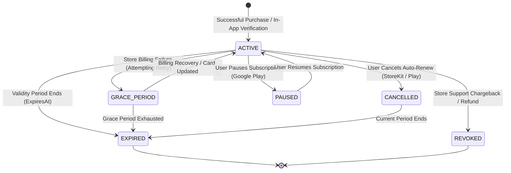
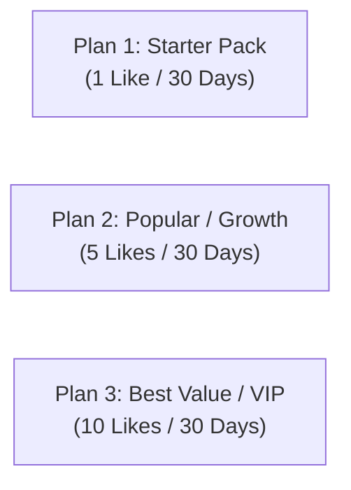
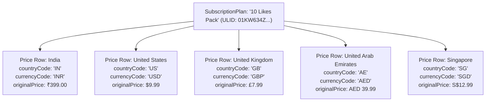
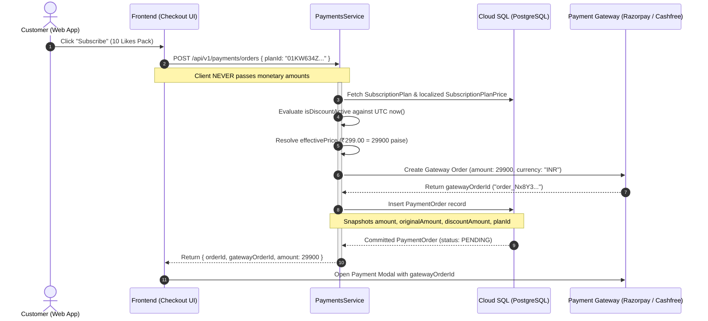
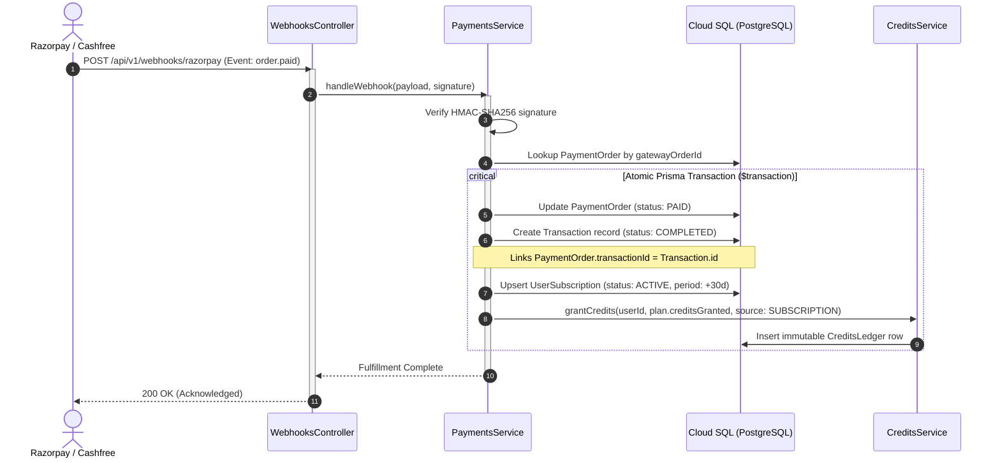

# 🏷️ Subscription Plans & Pricing Administration

This guide provides a comprehensive operational and architectural reference for administrators, finance operators, and backend engineers managing subscription plans, localized geo-pricing, promotional discount campaigns, and audit trails in BreathAway.

---

## 🎯 Executive Overview & Architectural Principles

The subscription and pricing architecture is governed by five foundational engineering principles:

1. **The "Dumb Client" Security Model**: The mobile and web frontends never calculate prices, never determine discounts, and never send payable amounts to payment gateways. The client communicates solely its intent (`planId`). The backend acts as the sole authoritative pricing engine.
2. **Decoupled Plan vs. Price Modeling**: Subscription plans represent product tiers (benefits, credits, validity), while plan prices represent localized, country-specific monetary values. A plan's immutable identity (`ULID`) never changes when its price changes.
3. **Bi-Temporal Audit Compliance**: Every price change, base hike, or promotional discount window automatically snapshots an immutable entry into `SubscriptionPlanPriceHistory`. Financial, tax, and legal audits can reconstruct the exact price running for any plan at any second in history.
4. **Authoritative Server-Side Checkout Locking**: When a checkout order is created, the system snapshots the active base price, promotional discount, and net payable amount in the `PaymentOrder` table before submitting the order to Razorpay or Cashfree.
5. **Zero-Trust Administrative Governance**: All administrative endpoints are guarded by **Google OpenID Connect (OIDC)** and verified against the live **Google Cloud Platform (GCP) IAM policy** (`AdminOidcAuthGuard`), completely eliminating shared database passwords or static API keys.

---

## 1. 🔄 What Are Subscriptions in Our Ecosystem?

In BreathAway, subscriptions provide users with enhanced matchmaking capabilities, premium discovery features, and recurring bundles of match credits ("Likes").

### Subscriptions vs. Consumable Credit Packs

| Attribute               | One-Off Consumables (Credit Top-Ups)               | Subscription Plans (Passes & Tiers)                     |
| :---------------------- | :------------------------------------------------- | :------------------------------------------------------ |
| **Primary Model**       | Ad-hoc credit packs (e.g., 5 Likes pack).          | Bundled tier (e.g., 10 Likes + 30 days validity).       |
| **Duration / Validity** | Credits expire per individual credit batch policy. | Fixed validity period (e.g., 30 days from purchase).    |
| **Billing Mechanism**   | Instant single-charge payment order.               | In-App Purchases (mobile) or fixed validity pass (web). |
| **User State Machine**  | Modifies `UserCredit` balance directly.            | Governed by `UserSubscription` state machine.           |

### The Subscription Lifecycle (`UserSubscription`)

A user can have at most **one active subscription tier** at any given moment. The user's subscription lifecycle follows a strict finite state machine:



- **`ACTIVE`**: The subscription is currently paid, valid, and active. The user enjoys all tier benefits and receives plan credits.
- **`EXPIRED`**: The validity period has ended. Background maintenance sweeps (`expireSubscriptions()`) safely transition overdue records to `EXPIRED`.
- **`CANCELLED`**: Auto-renew is disabled in the mobile store; tier access remains active until `currentPeriodEnd`.
- **`GRACE_PERIOD`**: A temporary billing failure occurred; store platforms allow temporary access while retrying payment methods.
- **`REVOKED`**: Terminated immediately by store customer support following a chargeback or refund.
- **`PAUSED`**: Google Play subscription pause initiated by the subscriber.

---

## 2. 📦 What Are Plans (`SubscriptionPlan`)?

A `SubscriptionPlan` represents a packaged offering within the product catalog.

### The "Rule of 3" Catalog Strategy

To minimize cognitive load, combat choice paralysis, and maximize checkout conversion rates, the BreathAway platform is architected to present a **maximum of 3 active subscription plans** simultaneously:



### Plan Entity Attributes (`SubscriptionPlan`)

| Field               | Type            | Description                                                                  |
| :------------------ | :-------------- | :--------------------------------------------------------------------------- |
| `id`                | `String (ULID)` | Immutable system identifier. Never changes across the plan's lifecycle.      |
| `name`              | `String`        | Customer-facing display title (e.g., `"10 Likes Pack"`).                     |
| `slug`              | `String`        | URL-friendly, lowercase alphanumeric slug (e.g., `"10-likes-pack"`). Unique. |
| `description`       | `String?`       | Value proposition and marketing copy displayed in client apps.               |
| `creditsGranted`    | `Int`           | Match/like credits provisioned to the user upon initial purchase or renewal. |
| `validityDays`      | `Int`           | Active duration in days (e.g., `30` for monthly passes).                     |
| `trialDurationDays` | `Int`           | Number of free trial days before initial store charge (default `0`).         |
| `appleProductId`    | `String?`       | Correlated Apple App Store Product ID (e.g., `"com.breathaway.pack10"`).     |
| `googleProductId`   | `String?`       | Correlated Google Play Billing Product ID (e.g., `"com.breathaway.pack10"`). |
| `sortOrder`         | `Int`           | Priority sort index for rendering order in client carousels.                 |
| `isActive`          | `Boolean`       | Catalog visibility flag. Inactive plans cannot be purchased by new users.    |

> [!IMPORTANT]
> **Immutable Plan Identity**: When modifying marketing text, sort order, or localized prices, **never delete and recreate a plan**. Updating the existing plan preserves customer subscription continuity, past payment records, and renewal webhooks.

---

## 3. 🌍 Subscription Plan Prices (`SubscriptionPlanPrice`) & Multi-Currency Geo-Pricing

A single `SubscriptionPlan` has a **1-to-Many** relationship with `SubscriptionPlanPrice`.

### Purchasing Power Parity (PPP) & Regional Pricing

A plan offering 10 Likes cannot be sold at the exact same dollar conversion rate globally. A ₹399 (~$4.80) price point in India might convert to $9.99 in the United States, £7.99 in the United Kingdom, and AED 39.99 in the United Arab Emirates.



### Database Constraint

Every price row is uniquely constrained:

```prisma
@@unique([planId, countryCode, currencyCode])
```

This guarantees that no plan can ever have ambiguous or duplicate pricing rows for the same country and currency combination.

### The 4-Tier Geo-Resolution Hierarchy

When a client queries active plans (`GET /api/v1/subscriptions/plans`), the backend resolves the customer's country through a strict four-tier hierarchy:

1. **Tier 1 (User Profile `User.countryCode`)**: If the request contains an authenticated JWT Bearer token and the user's database profile contains a verified country code, it is taken as the **first source of truth**.
2. **Tier 2 (Explicit Query Parameter `?countryCode=XX`)**: If unauthenticated or profile country is empty, explicit query parameters (e.g., from an in-app currency switcher) are respected.
3. **Tier 3 (Public Client IP via IPinfo Lite)**: For unauthenticated web guests, the public client IP extracted from reverse proxy headers (`X-Forwarded-For`) is geolocated via `IpGeolocationService`.
4. **Tier 4 (System Default Fallback `'IN'`)**: If geolocation fails, times out, or the IP is loopback/private, the server falls back to `DEFAULT_COUNTRY_CODE` (`'IN'`).

### Graceful Fallback (Empty-Screen Prevention)

If a user visits from a country (e.g., Canada `CA`) that does not yet have a custom regional pricing row, the database query checks both `[resolvedCountryCode, defaultCountryCode]`. If no `CA` price exists, it **gracefully falls back to the default country price row**, ensuring the checkout screen never crashes or renders blank.

---

## 4. 🏷️ Updating Plans: Base Price Hikes vs. Promotional Discounts

The pricing system uses a **Dual-Price Architecture**:

- `originalPrice`: The regular anchor / base retail price (e.g., ₹399.00).
- `discountedPrice`: The active promotional discounted price (e.g., ₹299.00).
- `discountStartsAt` & `discountEndsAt`: ISO 8601 UTC timestamp window defining when the discount is live.

### Mathematical Pricing Formulas

When querying active plans, the backend dynamically calculates promotional fields on the fly:

```text
isDiscountActive   = (discountedPrice != null) && (now >= discountStartsAt) && (now <= discountEndsAt)

effectivePrice     = isDiscountActive ? discountedPrice : originalPrice

discountPercentage = round(((originalPrice - effectivePrice) / originalPrice) * 100)

savingsAmount      = originalPrice - effectivePrice
```

### Client Presentation Shape

The customer frontend receives:

```json
{
  "originalPrice": 399.0,
  "effectivePrice": 299.0,
  "isDiscountActive": true,
  "discountPercentage": 25,
  "savingsAmount": 100.0,
  "discountEndsAt": "2026-10-25T23:59:59.000Z"
}
```

The UI displays **~~₹399~~ ₹299** with a **"Save ₹100 (25% OFF)"** badge and an optional countdown timer tied to `discountEndsAt`.

---

### Operational Scenarios & How-To Guide

#### Scenario A: Scheduling a Promotional Discount Window (Festive Sale / Diwali)

To schedule a discount from October 15, 2026 to October 25, 2026:

- **Method**: `PATCH`
- **URL**: `{{Base_Url}}/api/v1/admin/subscriptions/plans/{{planId}}/prices/{{priceId}}`
- **Headers**: `Authorization: Bearer {{DevGcpToken}}`
- **Payload**:

```json
{
  "discountedPrice": 299.0,
  "discountStartsAt": "2026-10-15T00:00:00Z",
  "discountEndsAt": "2026-10-25T23:59:59Z",
  "reason": "Diwali 2026 25% Off promotional campaign"
}
```

> [!TIP]
> **Zero Cron Maintenance**: You do **not** need to wake up at midnight on October 25 to turn off the discount. Because `isDiscountActive` evaluates UTC timestamps at the moment of request, the price automatically reverts to ₹399.00 at `2026-10-26T00:00:00Z`.

#### Scenario B: Permanent Base Price Increase (Price Hike)

If Finance approves increasing the base anchor price from ₹399 to ₹499:

- **Method**: `PATCH`
- **URL**: `{{Base_Url}}/api/v1/admin/subscriptions/plans/{{planId}}/prices/{{priceId}}`
- **Headers**: `Authorization: Bearer {{DevGcpToken}}`
- **Payload**:

```json
{
  "originalPrice": 499.0,
  "reason": "Annual base price increase from 399 to 499 approved by Finance"
}
```

The system automatically detects that `newOriginalPrice > oldOriginalPrice`, records a `BASE_PRICE_INCREASE` audit event, and snapshots the transition in history.

#### Scenario C: Terminating or Clearing an Active Promotion Early

To cancel an active sale immediately:

- **Method**: `PATCH`
- **URL**: `{{Base_Url}}/api/v1/admin/subscriptions/plans/{{planId}}/prices/{{priceId}}`
- **Headers**: `Authorization: Bearer {{DevGcpToken}}`
- **Payload**:

```json
{
  "discountedPrice": null,
  "discountStartsAt": null,
  "discountEndsAt": null,
  "reason": "Flash sale inventory target reached early; reverting to base price"
}
```

---

## 5. 📜 What and How Is Recorded in Plan History (`SubscriptionPlanPriceHistory`)?

Traditional databases overwrite rows in place, leaving zero trace of past pricing. When an auditor asks _"What was the price running for this plan on Valentine's Day?"_, a standard database cannot answer.

BreathAway solves this using **Bi-Temporal Audit Intervals** in `SubscriptionPlanPriceHistory`.

### How Bi-Temporal Intervals Work

Every price configuration exists as an active interval with `effectiveFrom` and `effectiveTo`:

```
Interval 1 (Initial Setup):
[2026-01-01 ---------------------> 2026-03-31 (effectiveTo closed)]
Base: ₹399 | Promo: null | Type: INITIAL_PRICE

Interval 2 (Flash Sale):
[2026-04-01 ---------------------> 2026-04-10 (effectiveTo closed)]
Base: ₹399 | Promo: ₹299 | Type: PROMO_SCHEDULED

Interval 3 (Base Hike - CURRENTLY ACTIVE):
[2026-04-11 ---------------------> NULL (active indefinitely)]
Base: ₹499 | Promo: null | Type: BASE_PRICE_INCREASE
```

When an admin updates a price row:

1. The backend finds the currently active history record (`effectiveTo IS NULL`).
2. It closes that record: `effectiveTo = now()`.
3. It inserts a new record: `effectiveFrom = now()`, `effectiveTo = null`, populated with the new price attributes, the admin's email (`changedByUserId`), and the justification reason (`changeReason`).

### Snapshot Fields in History

| History Column     | Description                                                                                                                                    |
| :----------------- | :--------------------------------------------------------------------------------------------------------------------------------------------- |
| `id`               | Unique history record ULID.                                                                                                                    |
| `priceId`          | Foreign key referencing `SubscriptionPlanPrice`.                                                                                               |
| `planId`           | Foreign key referencing `SubscriptionPlan`.                                                                                                    |
| `countryCode`      | ISO 2-letter country code (`IN`, `US`, etc.).                                                                                                  |
| `currencyCode`     | Currency code (`INR`, `USD`, etc.).                                                                                                            |
| `originalPrice`    | Regular anchor price snapshotted at that interval.                                                                                             |
| `discountedPrice`  | Promotional price snapshotted (or `null`).                                                                                                     |
| `discountStartsAt` | Promotional window start timestamp (or `null`).                                                                                                |
| `discountEndsAt`   | Promotional window end timestamp (or `null`).                                                                                                  |
| `effectiveFrom`    | UTC timestamp when this configuration became authoritative.                                                                                    |
| `effectiveTo`      | UTC timestamp when superseded (`null` = currently active).                                                                                     |
| `changeType`       | Change classification enum (`INITIAL_PRICE`, `BASE_PRICE_INCREASE`, `BASE_PRICE_DECREASE`, `PROMO_SCHEDULED`, `PROMO_ENDED`, `PROMO_UPDATED`). |
| `changedByUserId`  | Google OIDC email of the administrator who made the change.                                                                                    |
| `changeReason`     | Mandatory audit justification string.                                                                                                          |

### Querying the Audit Trail

Administrators can query the audit history via `GET /api/v1/admin/subscriptions/plans/:planId/prices/history`:

- **Date Range Query**: `?countryCode=IN&startDate=2026-01-01T00:00:00Z&endDate=2026-12-31T23:59:59Z`
- **Point-in-Time Query**: `?countryCode=IN&pointInTime=2026-02-14T12:00:00Z` reconstructs the exact active price configuration at that historical moment.

---

## 6. 💳 How It Links to Payment Orders (`PaymentOrder`)

When a customer checks out on the web application:



### The `PaymentOrder` Financial Snapshot

To guarantee financial non-repudiation, `PaymentOrder` freezes the exact numbers:

```prisma
model PaymentOrder {
  id             String             @id @default(ulid())
  userId         String
  planId         String
  amount         Int                // 29900 (paise charged at gateway)
  originalAmount Int?               // 39900 (anchor price in paise)
  discountAmount Int?               // 10000 (discount savings in paise)
  currency       String             // "INR"
  countryCode    String             // "IN"
  gateway        PaymentGateway     // RAZORPAY or CASHFREE
  status         PaymentOrderStatus // PENDING, PAID, FAILED, EXPIRED
  gatewayOrderId String             // order_Nx8Y3...
  transactionId  String?            @unique
}
```

Even if an admin changes the plan price 5 minutes later, the `PaymentOrder` remains frozen at the exact amounts agreed upon when checkout began.

---

## 7. 🏛️ How It Links to the Transactions Table (`Transaction`) & Ledger

Once the customer completes bank authorization at the gateway, fulfillment occurs via server-to-server webhook or client verification callback:



### The Relational Linkage Chain

Every financial transaction can be traced end-to-end through foreign keys:

```
Bank Settlement
   │ (gatewayTransactionId: "pay_Nx8Z...")
   ▼
Transaction [id: "01TX..."]
   │ (channel: WEB, amount: 299.00, creditsGranted: 10)
   ▼
PaymentOrder [id: "01PO..."]
   │ (amount: 29900, originalAmount: 39900, discountAmount: 10000)
   ▼
SubscriptionPlan [id: "01KW..."]
   │ (name: "10 Likes Pack", creditsGranted: 10, validityDays: 30)
   ▼
SubscriptionPlanPrice [id: "01PR..."]
   │ (originalPrice: 399.00, discountedPrice: 299.00)
   ▼
SubscriptionPlanPriceHistory [id: "01HI..."]
   │ (changeType: PROMO_SCHEDULED, changedByUserId: "admin@company.com")
   ▼
Audit & Compliance Log
```

### Idempotency & Double-Grant Protection

- `PaymentOrder.transactionId` is marked `@unique`. A `PaymentOrder` can produce at most **one** `Transaction` row.
- `Transaction.@@unique([gateway, gatewayTransactionId])` prevents duplicate credit issuance if Razorpay or Cashfree retries a webhook delivery.

---

## 8. 🛡️ Operational Best Practices & Legal Compliance

### Legal Compliance in Promotional Pricing

When configuring promotional pricing (`originalPrice` vs `discountedPrice`), operators must comply with consumer protection regulations (such as the **US FTC Guides Against Deceptive Pricing**, the **EU Omnibus Directive 2019/2161**, and the **Indian Consumer Protection E-Commerce Rules**):

1. **Genuine Anchor Pricing**: The `originalPrice` (strikethrough price) must be a real, bona fide retail price at which the plan was openly offered for a meaningful period prior to the promotion. Fabricating artificial reference prices (e.g., claiming a plan is "regularly ₹999" when it has never been sold above ₹399) violates e-commerce regulations.
2. **Definite Promotional Windows**: Always set explicit `discountStartsAt` and `discountEndsAt` UTC timestamps. Running perpetual "limited time discounts" that never expire is classified as deceptive advertising in multiple jurisdictions.
3. **Audit Trail Preservation**: Never attempt to delete `SubscriptionPlanPriceHistory` rows. Tax and trade regulatory authorities may request historical pricing records during platform audits.

### Postman Administrative Testing

All 7 administrative subscription plan endpoints are pre-configured in the project Postman collection under **APIs** ➔ **Admin** ➔ **SubscriptionPlans**:

- **Environment Variable**: Use the `Development` environment with `{{Base_Url}}` set to your target server.
- **Admin Token**: Generate a Google OIDC identity token via `gcloud auth print-identity-token` and store it in `{{DevGcpToken}}`.
- **Public Token**: For public-facing endpoints under `Public/Subscriptions`, authenticate as a test user and store the token in `{{AccessToken}}`.
