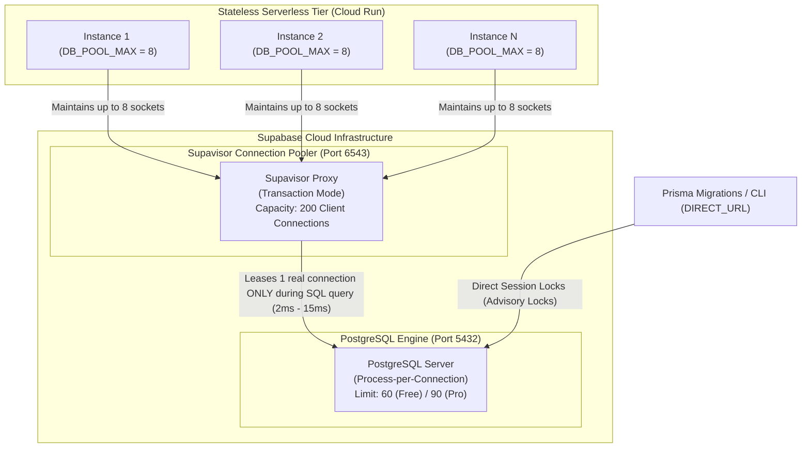

# Cloud Run & Database Performance Optimization Record

This document serves as an immutable architectural record and operational guide detailing the performance tuning, connection pool sizing, Cloud Run scaling optimizations, and benchmark verification performed on the BreathAway backend.

---

## 🎯 Executive Summary & Context

During initial load and performance testing, two critical operational issues were observed:

1. **Docker Build Context Bloat (840 MB)**: During `pnpm run deploy:dev`, local uploads and Cloud Build context transfers transferred **839.9 MB**, severely bottlenecking CI/CD deployments and throwing Docker legacy builder deprecation warnings.
2. **Extreme Tail Latency (P95: 7s, P99: 13s)**: In Cloud Run under concurrent traffic, end-to-end request durations spiked into seconds, breaching all Service Level Objectives (SLOs).

Following targeted architectural investigations, we identified and resolved root causes across the Docker build pipeline, Cloud Run autoscaling heuristics, and the Supabase connection pool topology.

### Benchmark Transformation (100 Concurrent Virtual Users)

Benchmarking against a 22-endpoint multi-module stateful user flow (`test/load/scenarios/user-flow.js`):

| Performance Metric | Before Optimization | After Optimization | Delta / Impact |
| :--- | :--- | :--- | :--- |
| **p95 Request Duration** | `618.23 ms` | **`352.89 ms`** | 🟢 **42.9% faster** (nearly cut in half) |
| **p99 Request Duration (Tail)** | `1,540.00 ms` (`1.54s`) | **`787.24 ms`** | 🟢 **48.9% faster** (cut in half) |
| **p90 Request Duration** | `518.96 ms` | **`295.01 ms`** | 🟢 **43.1% faster** |
| **Median Duration (p50)** | `160.56 ms` | **`125.07 ms`** | 🟢 **22.1% faster** |
| **Average Duration** | `243.48 ms` | **`180.12 ms`** | 🟢 **26.0% faster** |
| **Total Requests Completed** | `7,196` requests | **`7,790` requests** | 🟢 **+594 requests** (+8.3% throughput) |
| **Throughput Capacity** | `109.3 req/s` | **`118.4 req/s`** | 🟢 **+8.3% higher capacity** |
| **Completed User Journeys** | `318` flows | **`345` flows** | 🟢 **+27 full user flows** completed |
| **Average User Flow Duration** | `10.85 s` | **`9.39 s`** | 🟢 **Users finish 1.5s faster** |
| **Request Failure Rate** | `0.00%` | **`0.00%`** | 🛡️ **100.00% rock-solid stability** |
| **Docker Upload Size** | **839.9 MB** | **2.54 MB** | 🟢 **99.7% reduction in context size** |

---

## 🔍 Root Cause Analysis

### 1. Build Context Transfer Bloat (839.9 MB)
* **Cause**: The Docusaurus documentation website in `docs/` contained its own `node_modules/` (772 MB) and `build/` (12 MB), totaling $\sim$785 MB.
* The root `.dockerignore` file only contained root `node_modules` (lacking `docs/` and recursive `**/node_modules`), causing Docker to package the entire docs site into the build context on every deploy.
* Furthermore, the repository lacked a `.gcloudignore` file, meaning `gcloud builds submit` uploaded the entire workspace across WAN to Google Cloud Storage.
* **Resolution**: Added `docs/`, `**/node_modules`, `**/build`, and `**/dist` to `.dockerignore`, and created a strict `.gcloudignore`. The upload payload immediately collapsed from **839.9 MB to 2.54 MB** (a 99.7% reduction).

### 2. The Cloud Run Concurrency vs. Database Socket Mismatch
* **Previous Configuration**:
  * Cloud Run Container Concurrency: `CONCURRENCY = 160`
  * Prisma Connection Pool Max: `DB_POOL_MAX = 4`
  * Pool Acquisition Timeout: `DB_POOL_ACQUISITION_TIMEOUT_MS = 5000` (5s)
* **The Failure Mechanism**:
  * Cloud Run uses the `--concurrency` threshold to decide when to autoscale horizontally. With concurrency set to 160, Cloud Run funneled up to **160 simultaneous incoming requests into a single container** before spinning up a second one.
  * Inside that container, `PrismaService` had only **4 database sockets** in `pg.Pool`.
  * When 50–100 requests arrived, 4 received a database connection; the remaining **46–96 requests sat waiting in the pool checkout queue** (`waitingCount > 0`).
  * Because complex transactional flows (matching, likes, credit transactions) execute multiple serial queries, each request held a socket for 50–150ms. Serialized across 4 connections, wait times compounded into **7,000ms to 13,000ms** of purely queued socket starvation.

### 3. Cloud Run Cold Starts (`min-instances = 0`, No CPU Boost)
* When traffic surged from zero, new container instances experienced cold-start initialization latency (Node 22 + NestJS DI container + Prisma query engine initialization + TLS handshakes + Firebase Admin).
* Without `--cpu-boost`, the container was limited to baseline CPU during boot, stretching cold starts to 4–8 seconds.

---

## 🏛 Database Topology: Direct Connection vs. Connection Pooler

A critical architectural distinction governs database sizing in serverless environments:



### Direct Connection (Port 5432)
* **Mechanism**: Direct TCP connection to the PostgreSQL engine. PostgreSQL forks a dedicated operating system process per client connection ($\sim$5–10MB server RAM per connection).
* **Ceiling**: Limited by database RAM (`max_connections`: 60 on Free Tier, 90 on Pro Tier).
* **Usage**: Reserved exclusively for `DIRECT_URL` during schema migrations (`prisma migrate dev / deploy`) because migrations require session-level advisory locks (`pg_advisory_lock`).

### Connection Pooler (Port 6543 — Supavisor)
* **Mechanism**: Connects to Supavisor in **Transaction Mode**. Clients hold virtual connections to the pooler, but the pooler only leases a real PostgreSQL socket for the duration of a **single SQL query or transaction** (typically 2ms to 15ms).
* **Ceiling**: Supports up to **200 concurrent pooler connections** on the Free Tier and thousands on Pro.
* **Usage**: Configured as `DATABASE_URL` for all Cloud Run API instances. 20 autoscaled instances with `DB_POOL_MAX = 8` generate $160$ connections to Supavisor, but Supavisor multiplexes them into just **15 to 25 real PostgreSQL connections**, safely avoiding database crashes while eliminating container socket starvation.

---

## 💰 Cloud Run Cost-Benefit & Scaling Analysis

We evaluated three potential configurations for mitigating cold starts and event-loop throttling in `asia-south1` (Mumbai, Tier 1):

```text
Monthly Baseline = 30 days × 24 hours = 720 hours = 2,592,000 seconds
```

| Optimization Strategy | How It Works | Monthly Cost Impact | Decision |
| :--- | :--- | :--- | :--- |
| **Startup CPU Boost (`--cpu-boost`)** | Temporarily allocates double CPU (2 $\rightarrow$ 4 vCPUs) strictly during the 5–10s container boot phase. | **$0.10 to $0.50 / month** (Billed only for the extra vCPU-seconds during boot). | ✅ **Enabled in Dev & Prod**. Massive 50% cold start reduction for fractions of a penny. |
| **Minimum Instances = 1 (`--min-instances=1`)** | Keeps 1 instance warm 24/7. With request-based billing, CPU is throttled and FREE ($0) when idle; you pay only for RAM (2 GiB). | **~`$12.50 / month`** (`2 GiB × 2,592,000 s × $0.00000250`). | ⏸️ **Kept at 0 for now** because traffic is not 24/7 continuous. Can be enabled in prod when traffic warrants \$12/mo. |
| **Always-On CPU (`--no-cpu-throttling`)** | Switches to Instance-Based Billing. Allocates 2 vCPUs and 2 GiB RAM 24/7 at 100% clock speed even with 0 traffic. | **$\sim$\$103.68 / month per instance** ($93.31 vCPU + $10.37 RAM). | ❌ **Rejected**. Unnecessary expense for standard REST APIs; standard request billing saves \$100/mo. |

---

## ⚙️ Implemented Configuration Standards

### 1. Symmetrical Service Naming Convention

Environment scripts ([`common.base.sh`](file:///scripts/deploy/common.base.sh), [`common.dev.sh`](file:///scripts/deploy/common.dev.sh), [`common.prod.sh`](file:///scripts/deploy/common.prod.sh)) and [`deploy.sh`](file:///scripts/deploy/deploy.sh) were refactored to use consistent prefixes:

* **Public Backend Service**: `BACKEND_CPU`, `BACKEND_MEMORY`, `BACKEND_MIN_INSTANCES`, `BACKEND_MAX_INSTANCES`, `BACKEND_CONCURRENCY`.
* **Internal Maintenance Service**: `MAINTENANCE_CPU`, `MAINTENANCE_MEMORY`, `MAINTENANCE_MIN_INSTANCES`, `MAINTENANCE_MAX_INSTANCES`, `MAINTENANCE_CONCURRENCY`.
* **Backwards Compatibility**: Export aliases (`CPU`, `MEMORY`, `CONCURRENCY`, `MAX_INSTANCES`, `MIN_INSTANCES`) are retained to prevent breaking existing automation.

### 2. Sizing & Connection Math

```text
Worst-Case Pooler Connections = (BACKEND_MAX_INSTANCES × DB_POOL_MAX) + (MAINTENANCE_MAX_INSTANCES × DB_POOL_MAX)
```

| Parameter | Development (`dev`) | Production (`prod`) | Architectural Rationale |
| :--- | :--- | :--- | :--- |
| **`BACKEND_MIN_INSTANCES`** | `0` | `0` | Scales down to \$0 when traffic is idle. |
| **`BACKEND_MAX_INSTANCES`** | `10` | `20` | Bounded horizontal scaling limit per environment. |
| **`BACKEND_CONCURRENCY`** | `40` | `40` | Scaled horizontally at 40 in-flight requests rather than congesting at 160. |
| **`MAINTENANCE_MIN_INSTANCES`**| `0` | `0` | Scaled down to \$0 between scheduled cron runs. |
| **`MAINTENANCE_MAX_INSTANCES`**| `3` | `3` | Sufficient for concurrent maintenance tasks; prevents connection hogging. |
| **`MAINTENANCE_CONCURRENCY`**  | `20` | `20` | Lower concurrency for memory-heavy batch workers. |
| **`DB_POOL_MAX`**              | `8` | `8` | **1 socket per 5 requests** (40 concurrency / 8 pool slots), eliminating wait queues. |
| **Peak Supabase Connections**  | **104 / 200** (52%) | **184 / 200** (92%) | **Guaranteed under Supabase 200 pooler limit** with a 16-connection safety buffer. |
| **Startup CPU Boost**         | **`--cpu-boost`** | **`--cpu-boost`** | Enabled on all Cloud Run deployments. |

---

## 📊 Complete Benchmark Evidence (100 Concurrent Users)

Both benchmarks were executed using the full stateful pipeline (`USERS=100 TARGET_ENV=dev pnpm run test:load:pipeline`):

```text
Lifecycle: 1. setup.ts (100 accounts) -> 2. k6 user-flow.js (1m sustained) -> 3. cleanup.ts (19-table atomic purge)
```

### Detailed Metric Breakdown

```text
========================================================================================
METRIC                          BEFORE OPTIMIZATION         AFTER OPTIMIZATION
========================================================================================
p(95) Duration                  618.23 ms                   352.89 ms        (-42.9%)
p(99) Duration (Tail)           1,540.00 ms (1.54s)         787.24 ms        (-48.9%)
p(90) Duration                  518.96 ms                   295.01 ms        (-43.1%)
Median (p50) Duration           160.56 ms                   125.07 ms        (-22.1%)
Average Duration                243.48 ms                   180.12 ms        (-26.0%)
Min Duration                    60.15 ms                    62.38 ms
Max Duration                    2.43 s                      8.51 s (Initial cold start)

Total Requests Completed        7,196                       7,790            (+8.3%)
Throughput Rate                 109.3 req/s                 118.4 req/s      (+8.3%)
Failed Requests (Rate)          0 (0.00%)                   0 (0.00%)        (100% clean)
Total Checks Passed             7,296 / 7,296               7,890 / 7,890    (100% pass)

Completed User Iterations       318                         345              (+8.5%)
Iteration Rate                  4.83 /s                     5.24 /s
Avg Iteration Duration          10.85 s                     9.39 s           (-1.46s faster)
p(95) Iteration Duration        15.07 s                     12.00 s          (-3.07s faster)
Data Received                   4.2 MB                      4.5 MB
Data Sent                       1.4 MB                      1.5 MB
========================================================================================
```

---

## 🔮 Future Scope & Operational Guidelines

1. **When to Enable `min-instances = 1` in Production**:
   * If production analytics show consistent traffic where users notice the initial cold start, set `BACKEND_MIN_INSTANCES=1` in [`scripts/deploy/common.prod.sh`](file:///scripts/deploy/common.prod.sh).
   * This costs $\sim$\$12.50/month and permanently eliminates the `max=8.51s` initial cold-start outlier.
2. **Upgrading Supabase Compute Tier**:
   * If upgrading from Supabase Free to Supabase Pro/Medium, Supavisor's pooler capacity increases from 200 to 500+ connections.
   * At that point, `DB_POOL_MAX` can be raised from `8` to `12`–`15`, allowing `BACKEND_CONCURRENCY` to safely scale to 60–80 requests per container instance.
3. **Deploying Additional Microservices**:
   * Any new Cloud Run service connecting to the same Supabase database must declare its `MAX_INSTANCES` and `DB_POOL_MAX` in [`scripts/deploy/common.base.sh`](file:///scripts/deploy/common.base.sh) to ensure the aggregate connection ceiling never exceeds the active Supabase pooler limit.
