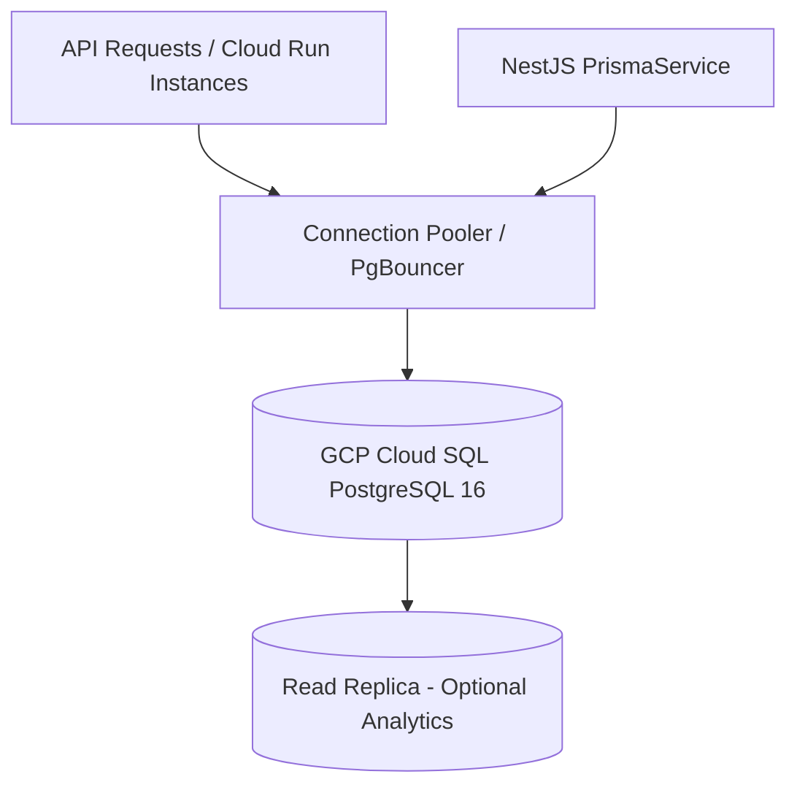
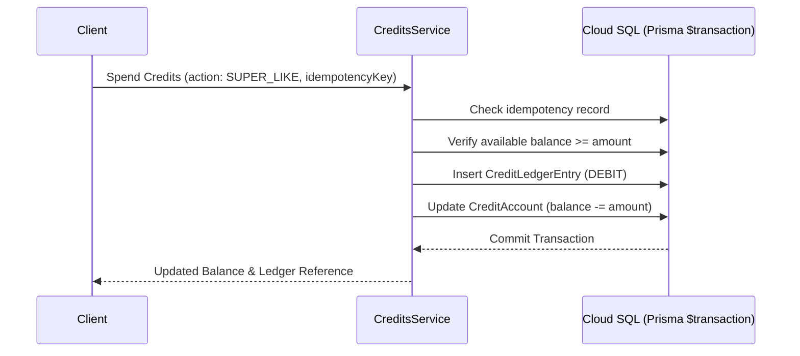

# Database & Prisma ORM Architecture

BreathAway utilizes **PostgreSQL** hosted on **Google Cloud SQL** as its primary relational data store, accessed and managed through the **Prisma ORM** in NestJS.

This document details the database architecture, schema design principles, connection pooling, transaction isolation, and the double-entry accounting ledger used for user credits.

---

## 🏛 Database Stack & Topology



| Component              | Technology                       | Role                                                     |
| :--------------------- | :------------------------------- | :------------------------------------------------------- |
| **Engine**             | PostgreSQL 16                    | Primary ACID relational database                         |
| **Hosting**            | GCP Cloud SQL                    | Managed database with automated backups and failover     |
| **ORM**                | Prisma ORM v6 / v5               | Type-safe query builder, schema modeling, and migrations |
| **Connection Pooling** | Cloud SQL Auth Proxy / PgBouncer | Manages connection limits under stateless autoscaling    |
| **Ledger Model**       | Double-Entry Bookkeeping         | Tamper-evident accounting for user credit balances       |

---

## 🔒 Connection Pooling & Stateless Cloud Run

Because the backend runs on GCP Cloud Run with horizontal autoscaling (0 to N instances), unmonitored database connections can quickly saturate PostgreSQL's `max_connections`.

### 1. Bounded Node-Postgres (`pg.Pool`) Adapter

`PrismaService` configures a bounded `pg.Pool` with the `@prisma/adapter-pg` driver adapter. Limits are tightly bounded for serverless autoscaling via environment variables:

- `DB_POOL_MAX` (default: 4)
- `DB_POOL_MIN` (default: 0)
- `DB_POOL_ACQUISITION_TIMEOUT_MS` (default: 5,000ms)
- `DB_POOL_IDLE_TIMEOUT_MS` (default: 10,000ms)
- `DB_POOL_STATEMENT_TIMEOUT_MS` (default: 15,000ms)

`PrismaService` implements `OnModuleInit` and `OnModuleDestroy` to cleanly connect on container boot and drain the pool on SIGTERM.

### 2. Real-Time Pool Telemetry & Contention Monitoring

`PrismaService` exposes `getPoolStatus(): DatabasePoolStatus` to report real-time saturation metrics:

- `totalCount`: Total clients in the pool (idle + active).
- `idleCount`: Available idle connections.
- `activeCount`: Checked-out connections (`totalCount - idleCount`).
- `waitingCount`: Queued queries waiting for an available client socket.
- `max`: Configured capacity limit.
- `utilizationPercent`: Active utilization percentage (`(activeCount / max) * 100`).

The pool registers lifecycle listeners for `connect`, `remove`, and `error`. Additionally, client checkout (`acquire`) inspects `waitingCount`: if queueing occurs (`waitingCount > 0`), a warning log (`pool_contention_detected`) is immediately dispatched to GCP Cloud Logging.

### 3. Query Performance & Slow Query Telemetry

`PrismaClient` is configured to emit query events via `{ emit: 'event', level: 'query' }`.

- **Configurable Slow Query Threshold**: Queries exceeding `DB_SLOW_QUERY_THRESHOLD_MS` (default: 200ms) emit a structured `warn` log with `step: 'slow_query_detected'`, execution `durationMs`, `target`, parameterized `query` text, and current `pool` status.
- **Debug Query Logging**: When `DB_LOG_ALL_QUERIES=true`, all queries are logged at `debug` level with `step: 'db_query_executed'`.
- **Strict PII Redaction**: Query parameter bindings (`event.params`) are **never** logged to prevent leaking customer emails, passwords, auth tokens, or phone numbers into logs. Parameterized templates (`SELECT * FROM "User" WHERE email = $1`) provide full query structure without PII.

### 4. Terminus Readiness Probe Integration

The `/ready` health probe (`DatabaseHealthIndicator`) executes `SELECT 1` and embeds `prisma.getPoolStatus()` in the health indicator payload. GCP Cloud Run and SRE dashboards gain immediate insight into connection headroom on every health check:

```json
{
  "status": "ok",
  "info": {
    "database": {
      "status": "up",
      "pool": {
        "totalCount": 2,
        "idleCount": 2,
        "activeCount": 0,
        "waitingCount": 0,
        "max": 4,
        "utilizationPercent": 0
      }
    }
  }
}
```

### 5. Connection Offloading via Redis Active Session Caching

In a serverless autoscaling architecture on Google Cloud Run, the primary threat to Cloud SQL connection health is **repetitive, high-frequency read queries** triggered by auth guards. Because every protected route passes through `JwtAuthGuard`, validating user active status directly against PostgreSQL would require a socket checkout (`SELECT * FROM "User" WHERE id = $1`) on every single API request.

To protect the bounded `pg.Pool` (`DB_POOL_MAX = 4`):

- **In-Memory Set Offload**: Authenticated access token JTIs are cached in an in-memory Redis Set (`user:active:<userId>`).
- **96.7% Database Query Reduction**: During normal operational traffic, 29 out of 30 authenticated requests resolve in Redis without checking out a database client socket.
- **Contention Prevention**: Eliminates socket contention (`waitingCount > 0`) during traffic spikes, ensuring that database connections remain immediately available for write transactions (e.g. credit consumption, payments, matching).
- **Deep Dive**: See the dedicated [Redis JWT Active Session Caching](./jwt-cache.md) guide.

---

## 🛡 Prisma ORM Patterns & Best Practices

### 1. Dedicated Service Isolation

Controllers **never** inject `PrismaService` directly. All database access must be encapsulated within domain Services or Repositories:

```typescript
// ❌ Anti-pattern: Direct Prisma access in Controller
@Controller('users')
export class UserController {
  constructor(private readonly prisma: PrismaService) {}
}

// ✅ Recommended: Service encapsulating business and data logic
@Injectable()
export class UserService {
  constructor(
    private readonly prisma: PrismaService,
    private readonly logger: LoggerService,
  ) {}
}
```

### 2. Preventing N+1 Query Problems

Prisma provides fluent relational queries. Always use explicit `select` or `include` rather than querying related entities in iterative loops:

```typescript
// ✅ Optimized query fetching user with verified identity and active preferences
const user = await this.prisma.user.findUnique({
  where: { id: userId },
  include: {
    identity: {
      select: { id: true, verificationStatus: true, emailVerified: true },
    },
    preferences: true,
  },
});
```

### 3. Atomic Multi-Record Mutations ($transaction)

For any operation modifying multiple dependent tables, use Prisma's `$transaction` API to maintain strict ACID invariants:

```typescript
await this.prisma.$transaction(async (tx) => {
  // 1. Mark like as mutual
  const match = await tx.match.create({
    data: { userAId, userBId, status: MatchStatus.ACTIVE },
  });

  // 2. Initialize chat channel
  await tx.chatChannel.create({
    data: { matchId: match.id, type: ChannelType.DIRECT },
  });

  return match;
});
```

### 4. Atomic Compare-and-Swap (CAS) for Session Concurrency

To defend against concurrent refresh token rotation races without acquiring heavy table-level write locks, the backend executes atomic Compare-and-Swap (CAS) queries directly via Prisma's `updateMany`:

```typescript
const updateResult = await tx.userSession.updateMany({
  where: { id: session.id, revokedAt: null },
  data: { revokedAt: DateUtil.now() },
});
```

Because `updateMany` in PostgreSQL evaluates `WHERE id = ... AND revokedAt IS NULL` atomically within the row lock of the write, only the first transaction succeeds (`count === 1`). Any concurrent runner receives `count === 0` and is safely diverted to breach containment.

---

## 🔑 User Session Storage & Index Strategy

Active authentication sessions are tracked in the `UserSession` model to support Refresh Token Rotation (RTR), device auditing, and token family breach containment.

### Schema & Index Layout

```prisma
model UserSession {
  id        String   @id @default(ulid())
  userId    String
  user      User     @relation(fields: [userId], references: [id], onDelete: Cascade)
  jti       String   @unique
  tokenHash String   @unique @db.Char(64)
  familyId  String
  deviceId  String?
  userAgent String?
  ipAddress String?
  expiresAt DateTime @db.Timestamptz
  revokedAt DateTime? @db.Timestamptz
  createdAt DateTime @default(now()) @db.Timestamptz
  updatedAt DateTime @updatedAt @db.Timestamptz

  @@index([userId])
  @@index([familyId])
  @@index([expiresAt])
}
```

### Index Purpose & Query Path Matrix

| Index         | Type               | Hot-Path Query Purpose                                                                                                         |
| :------------ | :----------------- | :----------------------------------------------------------------------------------------------------------------------------- |
| `jti`         | B-Tree (`@unique`) | $O(1)$ token lookup during `/api/v1/auth/refresh`.                                                                             |
| `tokenHash`   | B-Tree (`@unique`) | Prevents duplicate hash collisions; enables forensic hash verification.                                                        |
| `[userId]`    | B-Tree (`@@index`) | Enables instant revocation of all user sessions during global signout or account deletion (`onDelete: Cascade`).               |
| `[familyId]`  | B-Tree (`@@index`) | Accelerates targeted single-device signouts and instant lineage invalidation during RFC 6819 token reuse breach containment.   |
| `[expiresAt]` | B-Tree (`@@index`) | Powers index-only scans for the weekly Cloud Scheduler data hygiene job (`POST /api/v1/internal/jobs/purge-expired-sessions`). |

---

## 💰 Double-Entry Credit Ledger Architecture

User credits (used for premium actions, super-likes, and profile boosts) are modeled as a **double-entry ledger** to ensure financial auditability and prevent balance drift.

### Core Data Models

- **`CreditAccount`**: Represents a user's balance container (`AVAILABLE`, `ESCROW`, `LOCKED`).
- **`CreditLedgerEntry`**: Immutable transaction log recording every debit (`DEBIT`) and credit (`CREDIT`) with signed amounts and operational metadata (`txType`, `idempotencyKey`).



---

## 🔐 Field-Level Envelope Encryption (FLE) for PII

Beyond database-level encryption at rest (Cloud SQL / Supabase AES-256), BreathAway enforces **Application-Layer Envelope Encryption** via Google Cloud KMS to eliminate exposure risks in database dumps, analytical replicas, and logging pipelines:

| Entity / Column                                                  | Strategy                    | Cipher Details                                                                               | Decryption Context                                                                                                                                                     |
| :--------------------------------------------------------------- | :-------------------------- | :------------------------------------------------------------------------------------------- | :--------------------------------------------------------------------------------------------------------------------------------------------------------------------- |
| **`Identity`** (`publicValueCiphertext`, `platformIdCiphertext`) | Dedicated Envelope Columns  | AES-256-GCM data key wrapped by Cloud KMS; deterministic HMAC `publicValueHash` for indexing | Transparently resolved by `IdentitiesService` during authenticated profile resolution                                                                                  |
| **`Like.label`**                                                 | Compact Serialized Envelope | Format: `enc:v1:<keyId>:<ivBase64>:<tagBase64>:<wrappedKeyBase64>:<ciphertextBase64>`        | Decrypted on the fly by `LikesService.attachPublicValue` and `MatchesService`                                                                                          |
| **`UserProfile`** (`firstName`, `lastName`)                      | Compact Serialized Envelope | Format: `enc:v1:<keyId>:<ivBase64>:<tagBase64>:<wrappedKeyBase64>:<ciphertextBase64>`        | Decrypted transparently by `ProfilesService`, `DecryptionInterceptor`, `NotificationsModule`, `MatchesService`, `ChatsService`, `BlocksService`, and `PaymentsService` |

### Why Like Labels & Profile Names are Encrypted

1. **Like Labels (Side-Channel Elimination)**: Personal annotations on likes (e.g. _"Angela from gym"_) act as an indirect identifier or side-channel that could otherwise deanonymize target identities even when contact details are encrypted. Storing labels with envelope encryption ensures raw database inspection cannot reveal real-world names associated with target identities.
2. **User Profile Names (Zero-Knowledge Invariant)**: Storing customer names (`firstName`, `lastName`) under application-level envelope encryption prevents plaintext PII exposure across database snapshots, replication streams, support tooling, and hosting provider infrastructure (Supabase/PostgreSQL).
3. **GDPR & Privacy Compliance**: Prevents unconsented third-party PII storage and shields personal names and relationship data (GDPR Articles 5, 6, 9, 25, 32, and 34).
4. **KMS Key Isolation**: Decryption requires authorized IAM access to Google Cloud KMS. Even in the event of an arbitrary database dump exfiltration, ciphertext cannot be decrypted without GCP KMS credentials.
5. **Batch Decryption & Interceptor Pipeline**: High-throughput list queries leverage `IdentityCryptoService.decryptBatch()` (KMS key deduplication with in-memory DEK caching), while outbound HTTP responses are automatically processed by `DecryptionInterceptor`.

---

## 🔄 Migration & Schema Evolution Guidelines

- **Schema Source of Truth**: `prisma/schema.prisma` defines models, indexes, relations, and enums.
- **Migration Generation**: Local migration creation via:
  ```bash
  npx prisma migrate dev --name descriptive_migration_name
  ```
- **Production Migrations**: Executed in CI/CD before deploying new Cloud Run container revisions:
  ```bash
  npx prisma migrate deploy
  ```
- **Zero-Downtime Rule**: Never drop or rename columns in a single release. Follow expand-contract deployment (add column -> dual write -> backfill -> switch read -> deprecate old column).
