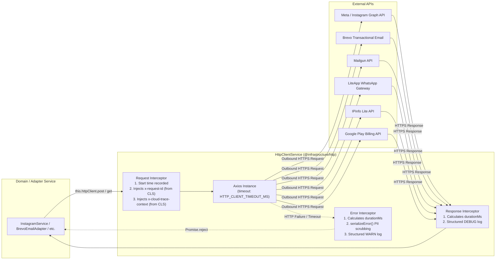

# Resilient External HTTP Clients

This guide details the centralized, resilient HTTP client architecture of the BreathAway backend, designed to eliminate scattered third-party HTTP libraries, propagate distributed tracing headers, enforce bounded execution timeouts, and provide clean dependency injection testing.

---

## 1. Overview & Motivation

In a high-scale microservice or modular monolith environment running on **Google Cloud Run**, outbound HTTP requests to external third-party APIs (e.g. Meta Graph API, Google Play Developer API, Brevo, Mailgun, LiteApp, IPinfo) can introduce significant operational vulnerabilities if unmanaged:

1. **Hung Sockets & Connection Starvation**: Default HTTP clients (like unconfigured Axios) do not enforce execution timeouts, risking hung sockets that exhaust container connection pools during third-party degradation.
2. **Severed Distributed Tracing**: When outbound calls do not propagate tracing and request correlation headers (`x-request-id`, `x-cloud-trace-context`), downstream services and external logs cannot be correlated back to the originating user request in GCP Cloud Logging.
3. **Log Inconsistency & PII Leaks**: Unhandled HTTP exceptions often dump raw Axios error payloads (containing authorization bearer tokens, customer emails, or private phone numbers) directly to standard output.
4. **Brittle Unit Testing**: Calling `import axios from 'axios'` directly in domain services forces test suites to rely on monkey-patching `jest.mock('axios')`, polluting global test state and breaking type safety.

To solve these challenges, all outbound HTTP communication is centralized in the global [`HttpClientModule`](file:///Users/mohitmalpani/Business/BreathAway/Backend/breathaway/src/infrastructure/http/http-client.module.ts) and [`HttpClientService`](file:///Users/mohitmalpani/Business/BreathAway/Backend/breathaway/src/infrastructure/http/http-client.service.ts).

---

## 2. Architectural Mechanics



### 2.1 Distributed Tracing Propagation (CLS)

`HttpClientService` inspects the active Continuation-Local Storage (`nestjs-cls`) context on every outgoing request:

- Extracts `requestId` and injects the `x-request-id` HTTP header.
- Extracts `traceContext` and injects the `x-cloud-trace-context` HTTP header.
- Preserves caller-supplied headers if custom values were explicitly provided.

### 2.2 Bounded Timeout Budgets

Every outbound request inherits a strict default timeout (configured via `HTTP_CLIENT_TIMEOUT_MS` in NestJS `ConfigService`, defaulting to `10,000ms`). Callers can override this on individual requests when longer operations are necessary (e.g. file uploads):

```typescript
await this.httpClient.post(url, data, { timeout: 15000 });
```

### 2.3 Milestone Duration Tracking & Error Sanitization

The client intercepts all completions and failures:

- **Success (`2xx`)**: Emits a `DEBUG` milestone log containing `method`, `url`, `statusCode`, and execution latency `durationMs`.
- **Failure**: Emits a `WARN` milestone log containing `method`, `url`, `statusCode`, `durationMs`, and safely scrubs sensitive headers and query tokens via `serializeError(error)`.
- Rejection reason is guaranteed to be an `Error` instance, ensuring compliance with strict TypeScript rules.

---

## 3. The `IHttpClient` Contract

The service implements the strongly-typed [`IHttpClient`](file:///Users/mohitmalpani/Business/BreathAway/Backend/breathaway/src/infrastructure/http/http-client.interface.ts) interface:

```typescript
export interface IHttpClient {
  get<T = unknown>(
    url: string,
    config?: AxiosRequestConfig,
  ): Promise<AxiosResponse<T>>;
  post<T = unknown>(
    url: string,
    data?: unknown,
    config?: AxiosRequestConfig,
  ): Promise<AxiosResponse<T>>;
  put<T = unknown>(
    url: string,
    data?: unknown,
    config?: AxiosRequestConfig,
  ): Promise<AxiosResponse<T>>;
  patch<T = unknown>(
    url: string,
    data?: unknown,
    config?: AxiosRequestConfig,
  ): Promise<AxiosResponse<T>>;
  delete<T = unknown>(
    url: string,
    config?: AxiosRequestConfig,
  ): Promise<AxiosResponse<T>>;
  request<T = unknown>(config: AxiosRequestConfig): Promise<AxiosResponse<T>>;
}
```

In addition, `HttpClientService` provides:

- **`axiosRef: AxiosInstance`**: Exposes the underlying instance for advanced streaming or multi-part configurations.
- **`isAxiosError(error: unknown): error is AxiosError`**: Type guard to safely inspect response status codes in `catch` blocks without importing `axios` directly.

---

## 4. Integrated Services & Consumers

The following services have been migrated from scattered `axios` imports to `HttpClientService`:

| Service                         | File Location                                                             | Purpose / External Destination                                                                  |
| :------------------------------ | :------------------------------------------------------------------------ | :---------------------------------------------------------------------------------------------- |
| **`IpGeolocationService`**      | `src/infrastructure/ip-geolocation/ip-geolocation.service.ts`             | Resolves ISO country code from public client IP via IPinfo Lite.                                |
| **`InstagramService`**          | `src/modules/instagram/instagram.service.ts`                              | Short-to-long OAuth token exchange and long-lived token rotation via Instagram Graph API.       |
| **`GoogleSubscriptionService`** | `src/modules/subscriptions/services/google-subscription.service.ts`       | Verifies Android in-app subscription purchase tokens via Google Play API.                       |
| **`BrevoEmailAdapter`**         | `src/modules/notifications/email/adapters/brevo.email.adapter.ts`         | Dispatches transactional HTML emails via Brevo v3 SMTP API.                                     |
| **`MailgunEmailAdapter`**       | `src/modules/notifications/email/adapters/mailgun.email.adapter.ts`       | Sends multipart/form-data emails with Basic Authentication via Mailgun API.                     |
| **`LiteAppWhatsAppAdapter`**    | `src/modules/notifications/whatsapp/adapters/liteapp.whatsapp.adapter.ts` | Dispatches WhatsApp template notifications via LiteApp gateway with 429 `Retry-After` handling. |

---

## 5. Dependency Injection & Unit Testing Standards

### Injecting in Services

Because `HttpClientModule` is decorated with `@Global()`, any domain or infrastructure provider can inject `HttpClientService` directly without importing `HttpClientModule` into feature modules:

```typescript
import { Injectable } from '@nestjs/common';
import { HttpClientService } from '@infrastructure/http';
import { BaseService } from '@core/base';
import { LoggerService } from '@core/logger';

@Injectable()
export class MyExternalIntegrationService extends BaseService {
  constructor(
    logger: LoggerService,
    private readonly httpClient: HttpClientService,
  ) {
    super(logger);
  }

  async fetchExternalData(endpoint: string): Promise<Data> {
    const response = await this.httpClient.get<Data>(endpoint);
    return response.data;
  }
}
```

### Unit Testing Without `jest.mock('axios')`

Never monkey-patch Axios globally in test files. Provide a clean, isolated mock for `HttpClientService`:

```typescript
import { Test, TestingModule } from '@nestjs/testing';
import { HttpClientService } from '@infrastructure/http';
import { MyExternalIntegrationService } from './my-external-integration.service';

describe('MyExternalIntegrationService', () => {
  let service: MyExternalIntegrationService;

  const mockHttpClient = {
    get: jest.fn(),
    post: jest.fn(),
    isAxiosError: jest.fn(
      (err: unknown) =>
        (err as { isAxiosError?: boolean })?.isAxiosError === true,
    ),
  };

  beforeEach(async () => {
    const module: TestingModule = await Test.createTestingModule({
      providers: [
        MyExternalIntegrationService,
        { provide: HttpClientService, useValue: mockHttpClient },
      ],
    }).compile();

    service = module.get<MyExternalIntegrationService>(
      MyExternalIntegrationService,
    );
  });

  it('should call external API with expected payload', async () => {
    mockHttpClient.get.mockResolvedValueOnce({
      status: 200,
      data: { result: 'ok' },
    });

    const result = await service.fetchExternalData(
      'https://api.example.com/v1',
    );

    expect(mockHttpClient.get).toHaveBeenCalledWith(
      'https://api.example.com/v1',
    );
    expect(result).toEqual({ result: 'ok' });
  });
});
```
