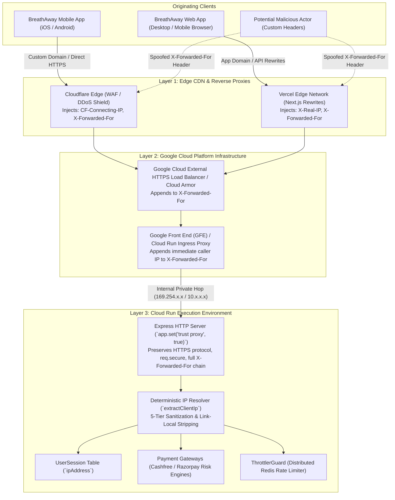

# Reverse Proxy Trust & Client IP Resolution Architecture

This document serves as the authoritative architectural record and operational guide governing reverse proxy trust and client IP resolution across the BreathAway backend.

---

## 🎯 Executive Summary & Architectural Invariant

> [!IMPORTANT]
> **Golden Rule**: **Never change `app.set('trust proxy', true)` to `1` in this codebase.**
> 
> Generic security checklists frequently recommend `trust proxy: 1` under the naive assumption that Cloud Run is a single-hop proxy. In BreathAway's production infrastructure, web and mobile clients connect through intermediate edge networks (Vercel Next.js edge rewrites, Cloudflare WAF/CDN, and Google Cloud External HTTPS Load Balancers).
> 
> Setting `trust proxy: 1` forces Express to trust only the immediate internal Google Front End (GFE) hop. It treats the intermediate edge proxy (Vercel or Cloudflare) as the "client", causing all users across the world to share the same proxy IP. This corrupts `UserSession.ipAddress`, triggers false-positive fraud blocks in payment gateways (Cashfree & Razorpay), breaks SSL protocol detection, and causes rate limiters to throttle all users under a single shared bucket.
> 
> Instead, BreathAway decouples Express reverse-proxy trust (`trust proxy: true`) from client IP resolution, enforcing a hardened, 5-layer deterministic extraction pipeline in [`extractClientIp()`](file:///Users/mohitmalpani/Business/BreathAway/Backend/breathaway/src/common/utils/request.utils.ts).

---

## 🏛 Multi-Hop Production Topology

In modern cloud production deployments, incoming requests never connect directly to the Cloud Run Linux container socket. The end-to-end request lifecycle spans multiple network boundaries:



---

## ⚠️ The Naive `trust proxy: 1` Fallacy

Generic audit scanners (e.g. SonarQube, basic OWASP checklists) routinely flag `app.set('trust proxy', true)` with the following theoretical argument:

> *"If you set `trust proxy: true`, Express trusts the entire `X-Forwarded-For` chain. An attacker can send a forged `X-Forwarded-For: 1.2.3.4` header, and Express will set `req.ip` to `1.2.3.4`."*

While that argument holds for an unconfigured Express app reading raw `req.ip` behind a single local Nginx reverse proxy, applying `trust proxy: 1` to a multi-hop Cloud Run deployment creates four catastrophic production failures:

### 1. `UserSession.ipAddress` Poisoning
Express evaluates `trust proxy: n` from **right to left** (walking backwards from the TCP socket):
- **Rightmost entry**: Appended by GFE (`Cloudflare Egress IP` or `Vercel Egress IP`).
- **With `trust proxy: 1`**: Express strips exactly one hop (GFE) and stops. It declares the next IP to the left as the client IP.
- **The Result**: The client IP resolves to Vercel's or Cloudflare's datacenter IP (`44.192.105.200`, `104.16.x.x`). Every active user session in the `UserSession` table records the same datacenter IP, permanently destroying audit trails, geolocation lookup, and security incident investigations.

### 2. Payment Gateway Fraud Rejection (Cashfree & Razorpay)
Both Cashfree and Razorpay require the genuine customer IP address when initializing checkout orders (`customer_details.customer_ip`):
- Payment gateway fraud models cross-reference the client IP against issuing bank location, BIN country, and device velocity.
- If all orders originate from a shared hosting/proxy datacenter IP, gateway risk engines flag the merchant account for automated credential stuffing or card-testing attacks, declining legitimate payments.

### 3. Rate Limiting Denial of Service (Global 429 Lockout)
The global rate limiter (`ThrottlerGuard` in `AppModule`) uses the client IP as its rate-tracking key. If `trust proxy: 1` collapses all incoming requests to Vercel's proxy IP, **all concurrent web users share the exact same rate limit bucket**. Within seconds of launch, the entire customer base receives `429 Too Many Requests`.

### 4. Express Protocol & Cookie Failures (`req.secure`)
When `trust proxy: 1` is configured and traffic traverses two hops (e.g. `Client -> Cloudflare -> Cloud Run`), Express treats the request as insecure HTTP because the `X-Forwarded-Proto: https` header was set by an upstream hop beyond the 1-hop horizon. This causes:
- Secure cookies (`SameSite=None; Secure`) to be rejected by modern browsers.
- HTTPS redirection middleware to enter infinite redirect loops.

---

## 🛡️ The Solution: Decoupled 5-Layer Deterministic IP Resolution

To achieve 100% resilience against both proxy collapse and header spoofing, BreathAway decouples Express container configuration from client IP extraction:

1. **Express Layer (`src/config/security.config.ts`)**:
   ```typescript
   export function configureSecurity(app: NestExpressApplication): void {
     // Trust upstream reverse proxy hops (GCP Cloud Run edge and upstream proxies like Vercel/Cloudflare)
     app.set('trust proxy', true);

     app.use(createSecurityMiddleware());
   }
   ```
   Enables Express to accurately recognize HTTPS, maintain full `req.ips` arrays, and handle multi-hop proxy forwarding.

2. **Resolution Layer ([`src/common/utils/request.utils.ts`](file:///Users/mohitmalpani/Business/BreathAway/Backend/breathaway/src/common/utils/request.utils.ts))**:
   All internal services, guards, interceptors, and decorators call `extractClientIp(req)`:

```typescript
export function extractClientIp(req: {
  headers?: Record<string, string | string[] | undefined>;
  ip?: string;
  socket?: { remoteAddress?: string };
}): string | undefined {
  if (!req) return undefined;

  // Tier 1: Cloudflare authoritative connecting IP
  // Cloudflare terminates the client connection and injects CF-Connecting-IP.
  // This header cannot be forged or manipulated by the client through Cloudflare.
  const cfIp = Array.isArray(req.headers?.['cf-connecting-ip'])
    ? req.headers?.['cf-connecting-ip'][0]
    : req.headers?.['cf-connecting-ip'];
  if (typeof cfIp === 'string' && cfIp.length > 0) {
    const cleaned = cleanIp(cfIp);
    if (cleaned) return cleaned;
  }

  // Tier 2: X-Real-IP header from upstream reverse proxy (Vercel, Nginx, ALB)
  // Set by Vercel edge runtime to the immediate connecting client IP.
  const realIp = Array.isArray(req.headers?.['x-real-ip'])
    ? req.headers?.['x-real-ip'][0]
    : req.headers?.['x-real-ip'];
  if (typeof realIp === 'string' && realIp.length > 0) {
    const cleaned = cleanIp(realIp);
    if (cleaned) return cleaned;
  }

  // Tier 3: X-Forwarded-For multi-hop chain with Link-Local & Private IP stripping
  // In Cloud Run, GFE appends the caller IP to the chain.
  // We parse the chain from left to right, stripping internal/link-local proxy IPs.
  const forwarded = req.headers?.['x-forwarded-for'];
  if (forwarded) {
    const rawList = Array.isArray(forwarded) ? forwarded.join(',') : forwarded;
    if (typeof rawList === 'string' && rawList.length > 0) {
      const parts = rawList
        .split(',')
        .map((entry) => cleanIp(entry))
        .filter((entry): entry is string => Boolean(entry && entry.length > 0));

      // Prefer the first public/routable client IP; fallback to first entry if all are internal
      const clientIp =
        parts.find((ip) => !isInternalOrLinkLocal(ip)) ?? parts[0];
      if (clientIp) return clientIp;
    }
  }

  // Tier 4: Express trusted proxy-resolved IP
  if (req.ip) {
    const cleanedExpressIp = cleanIp(req.ip);
    if (cleanedExpressIp) return cleanedExpressIp;
  }

  // Tier 5: Direct TCP socket fallback
  return cleanIp(req.socket?.remoteAddress);
}
```

---

## 🔍 Link-Local & Internal Hop Sanitization (`isInternalOrLinkLocal`)

In GCP Cloud Run, internal Google infrastructure components (GFE proxies, VPC network interfaces, and container sidecars) often communicate via link-local (`169.254.x.x`) or private RFC 1918 subnets (`10.x.x.x`, `172.16-31.x.x`).

[`isInternalOrLinkLocal()`](file:///Users/mohitmalpani/Business/BreathAway/Backend/breathaway/src/common/utils/request.utils.ts#L10-L58) rigorously filters out:
- **Loopback**: `127.0.0.1`, `::1`, `localhost`
- **Link-Local & Cloud Metadata**: `169.254.0.0/16` (GCP/AWS metadata and virtual bridge routers)
- **RFC 1918 Private Ranges**: `10.0.0.0/8`, `192.168.0.0/16`, `172.16.0.0/12`
- **IPv6 Local / Link-Local**: `fe80::/10`, `fc00::/7`, `fd00::/8`

If a client sends an `X-Forwarded-For` chain containing internal proxy hops prepended by intermediate balancers, `extractClientIp` automatically skips internal hops and locates the genuine public originating client IP.

---

## 🧪 Automated Verification Suite

This architecture is verified by 12 dedicated unit tests in [`request.utils.spec.ts`](file:///Users/mohitmalpani/Business/BreathAway/Backend/breathaway/src/common/tests/utils/request.utils.spec.ts):

| Test Case | Scenario Tested | Verified Outcome |
| :--- | :--- | :--- |
| `CF-Connecting-IP priority` | Request contains `cf-connecting-ip`, `x-real-ip`, and `x-forwarded-for` | Selects `cf-connecting-ip` (Cloudflare edge authoritative) |
| `X-Real-IP priority` | Request contains `x-real-ip` and multi-hop `x-forwarded-for` | Selects `x-real-ip` (Vercel edge authoritative) |
| `Multi-hop Vercel to Cloud Run` | `x-forwarded-for: 49.43.243.125, 44.192.105.200` | Selects public client `49.43.243.125`, ignoring Vercel proxy `44.192.105.200` |
| `Link-local GFE stripping` | `x-forwarded-for: 169.254.1.1, 49.43.243.125, 44.192.105.200` | Skips `169.254.1.1` GFE address, selects `49.43.243.125` |
| `Local development fallback` | All IPs are internal (`127.0.0.1, 10.0.0.1`) | Falls back gracefully to first entry without error |
| `Port number sanitization` | IPv4 (`49.43.243.125:443`) and IPv6 (`[2001:db8::1]:8080`) | Normalizes to clean IP strings (`49.43.243.125`, `2001:db8::1`) |

---

## 📋 Evaluation Guidelines for Future Reviews

When conducting security audits or automated PR reviews:

1. **Do NOT flag `app.set('trust proxy', true)` as a vulnerability**: This is an intentional architectural pattern designed for Cloud Run multi-hop proxy topology.
2. **Never change `trust proxy` to `1`**: Doing so breaks user tracking, payment gateway risk validation, and rate limiting.
3. **Always use `extractClientIp(req)`**: Never use raw `req.ip` directly in business logic, guards, or controllers.
