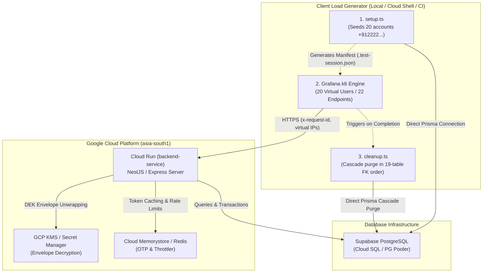

# Load & Benchmark Testing Guide (Grafana k6)

This guide documents the load testing infrastructure, benchmarking methodology, and execution instructions for the BreathAway NestJS backend using **[Grafana k6](https://k6.io/)**.

---

## 🎯 Purpose & Capabilities

The load testing suite validates system stability, throughput, and latency bounds under concurrent traffic spikes. It answers critical production questions:

1. **Capacity & Latency**: Does the API sustain >= 50 req/s while keeping P95 < 1500ms and P99 < 2500ms?
2. **Cloud Run Autoscaling**: How quickly do new container instances spin up during a sudden traffic spike?
3. **Database Connection Pool Headroom**: Does `PrismaService` suffer from socket starvation or connection checkout timeouts under peak load?
4. **Redis & Rate Limiting**: Do throttler guards and single-use OTP operations hold up without leaking connections or falsely rejecting valid traffic?
5. **KMS Cryptographic Overhead**: What is the performance cost of unwrapping encrypted AES-GCM identity envelopes under sustained load?

---

## 🏗 System Architecture

The load generator runs as an **external client (traffic injector)** firing concurrent HTTPS requests against the target environment (local server or GCP Cloud Run):



---

## 🛡️ Database Safety & Non-Pollution Lifecycle

Writing test records to a database used for QA can cause row bloat, foreign key deadlocks, and accidental SMS/WhatsApp messages. BreathAway enforces a strict **3-Stage Lifecycle**:

### 1. Deterministic Non-Routable Phone Numbers

- All benchmark test accounts use the Indian country code `+91` followed by prefix `2222` (e.g. `+912222000001` through `+912222000020`).
- Because valid Indian mobile numbers strictly start with `6`, `7`, `8`, or `9`, the `+912222...` prefix is **physically non-routable**.
- In addition, all like creation payloads pass `"notifyRecipientAnonymously": false` to suppress external webhook notifications.

### 2. Pre-Seeded Bounded Session Pool

- Instead of creating accounts dynamically inside the test loop, `setup.ts` pre-provisions a fixed pool of 20 benchmark accounts.
- Encrypts identity data keys via `IdentityCryptoService` and `GcpSecretsKeyManager` (AES-GCM envelopes).
- Grants 100 spendable credits in `CreditLedger` per user.
- Mints 15-minute JWT access tokens bound to the active service audience (`breathaway-mobile-app`).
- Writes credentials and headers to `test/load/.test-session.json`.

### 3. Automated Cascade Teardown

When the k6 run finishes (or is interrupted), `cleanup.ts` deletes all records created for the benchmark users across **19 database tables** in exact foreign-key order:

```text
PaymentOrder -> Notification -> Transaction -> UserSubscription -> Message -> ChatRoom -> Match -> Block -> Like -> CreditLedger -> Device -> UserSession -> NotificationPreference -> ConsentLedger -> UserProfile -> AuthCredential -> DsarExport -> Identity -> User
```

This leaves the Supabase database in a 100% clean state after every run.

---

## 📋 Scope of Tested Endpoints & Modules

The stateful user flow scenario (`test/load/scenarios/user-flow.js`) exercises **22 distinct endpoints across 9 core modules**:

| Module                      | Endpoints Tested                                                                                                | Action & Behavior                                                                                                                                                                                                                                               |
| :-------------------------- | :-------------------------------------------------------------------------------------------------------------- | :-------------------------------------------------------------------------------------------------------------------------------------------------------------------------------------------------------------------------------------------------------------- |
| **One-Time Passwords**      | `POST /api/v1/one-time-passwords/generate`<br/>`POST /api/v1/one-time-passwords/verify`                         | Generates a Redis-backed OTP token and immediately validates/consumes it (single-use). Ran on Iteration 0 per VU to test issuance and Redis TTL without tripping rate limits.                                                                                   |
| **Profiles**                | `GET /api/v1/profiles`<br/>`PATCH /api/v1/profiles`                                                             | Reads the user profile, then executes a live `PATCH` updating `firstName` to benchmark write latency on profile tables.                                                                                                                                         |
| **Identities**              | `GET /api/v1/identities`<br/>`GET /api/v1/identities/complete`                                                  | Retrieves masked identities, then calls the `/complete` route which benchmarks real **KMS envelope decryption** (AES-GCM DEK unwrapping) under concurrent load.                                                                                                 |
| **Preferences & Consents**  | `GET /api/v1/preferences`<br/>`PATCH /api/v1/preferences`<br/>`GET /api/v1/preferences/consents`                | Fetches notification toggles, performs a partial `PATCH` (`pushEnabled`, `emailEnabled`), and retrieves the GDPR Article 7 immutable consent audit ledger.                                                                                                      |
| **Credits & Transactions**  | `GET /api/v1/credits/balance`<br/>`GET /api/v1/credits/expiring`<br/>`GET /api/v1/credits/ledger`               | Reads spendable credit balance (100 credits granted during setup), fetches expiring credit buckets, and queries paginated ledger transaction history.                                                                                                           |
| **Subscriptions**           | `GET /api/v1/subscriptions/plans`<br/>`GET /api/v1/subscriptions/me`<br/>`GET /api/v1/subscriptions/me/history` | Fetches localized subscription plans, checks active subscription status (returns 200 or 404 `ActiveSubscriptionNotFoundException`), and reads subscription history.                                                                                             |
| **Blocks & Safety**         | `GET /api/v1/blocks`                                                                                            | Queries active block relationships for the user.                                                                                                                                                                                                                |
| **Devices & Notifications** | `GET /api/v1/notifications/unread-count`<br/>`GET /api/v1/devices`                                              | Fetches notification badge count and registered push devices.                                                                                                                                                                                                   |
| **Likes & Match Resolver**  | `GET /api/v1/likes`<br/>`POST /api/v1/likes/can-create`<br/>`POST /api/v1/likes`                                | Queries sent likes, executes pre-flight validation, and sends likes. **On Iteration 0, users are paired reciprocally ($0 \leftrightarrow 1, 2 \leftrightarrow 3, \dots$)**, which fires `MatchResolverService` to generate real `Match` and `ChatRoom` records. |
| **Matches & Realtime Chat** | `GET /api/v1/matches`<br/>`GET /api/v1/chats/rooms`<br/>`GET /api/v1/chats/supabase-token`                      | Reads active matches, retrieves the newly spawned encrypted chat rooms, and fetches a Supabase Realtime messaging JWT.                                                                                                                                          |

---

## 🚀 How to Run Load Tests

### Prerequisites

Ensure `k6` is installed on your local machine:

```bash
# macOS (via Homebrew)
brew install k6

# Debian / Ubuntu / GCP Cloud Shell
sudo apt-get install -y ca-certificates gnupg
curl -s https://dl.k6.io/key.gpg | sudo gpg --dearmor -o /usr/share/keyrings/k6-archive-keyring.gpg
echo "deb [signed-by=/usr/share/keyrings/k6-archive-keyring.gpg] https://dl.k6.io/deb stable main" | sudo tee /etc/apt/sources.list.d/k6.list
sudo apt-get update && sudo apt-get install -y k6
```

---

### Scenario A: Running Against Localhost

Use this during feature development to verify API latency and connection pooling before pushing code.

```bash
# Terminal 1: Start NestJS with adequate database pool size
DB_POOL_MAX=10 pnpm run start:dev

# Terminal 2: Run the all-in-one automated pipeline
pnpm run test:load:pipeline
```

---

### Scenario B: Running Against Cloud Run (Development Environment)

Deploy your backend container to Cloud Run, then point the benchmark suite directly at the Cloud Run service URL.

```bash
# Step 1: Deploy latest code to Cloud Run development service
pnpm run deploy:dev

# Step 2: Run the all-in-one automated pipeline against Cloud Run
TARGET_ENV=dev pnpm run test:load:pipeline
```

You can also target any custom deployment URL directly:

```bash
BASE_URL=https://backend-service-54c574542a-el.a.run.app pnpm run test:load:pipeline
```

---

### Scenario C: Scaling Concurrency Dynamically (Custom VUs / User Pool)

You can dynamically set the number of benchmark accounts and concurrent k6 Virtual Users (e.g. 50, 100, 200) directly from the command line using `USERS` (or `LOAD_TEST_USERS` or `VUS`):

```bash
# Run with 50 concurrent benchmark users against Cloud Run
USERS=50 TARGET_ENV=dev pnpm run test:load:pipeline

# Run with 100 concurrent benchmark users against local server
USERS=100 DB_POOL_MAX=30 pnpm run test:load:pipeline

# Customize duration along with user load (e.g. sustain 50 VUs for 60 seconds)
USERS=50 DURATION=60s TARGET_ENV=dev pnpm run test:load:pipeline
```

**How dynamic scaling works under the hood:**

1. `setup.ts`: Reads `USERS=50`, provisions 50 accounts (`+912222000001` through `+912222000050`), and saves them to `.test-session.json`.
2. `user-flow.js`: Automatically detects 50 accounts, dynamically calculates proportional warm-up stages (25% initial $\rightarrow$ 50 sustained $\rightarrow$ cooldown), and maps each VU 1:1 to an account.
3. `cleanup.ts`: Atomically purges all 50 accounts and their created database rows.

---

### Scenario D: Running in Google Cloud Shell (Zero WAN Latency)

Running k6 from your local machine includes home Wi-Fi and ISP WAN latency. To measure **pure server-to-server microsecond performance** inside the GCP datacenter (`asia-south1`):

1. Open **Google Cloud Shell** in the GCP Console.
2. Clone the repository and install k6 (using the Ubuntu instructions above).
3. Run the pipeline against the Cloud Run dev service:
   ```bash
   TARGET_ENV=dev pnpm run test:load:pipeline
   ```

---

## 📊 Summary of Pipeline Commands

| Command                        | Purpose                                                                                                                    | Profile                                    |
| :----------------------------- | :------------------------------------------------------------------------------------------------------------------------- | :----------------------------------------- |
| `pnpm run test:load:pipeline`  | **All-in-One Automated Pipeline:** Setup accounts $\rightarrow$ Run 22-endpoint user flow $\rightarrow$ Guaranteed cleanup | 5 $\rightarrow$ 20 VUs (1m30s)             |
| `pnpm run test:load:setup`     | Pre-seeds 20 benchmark accounts and signs 15-min JWTs                                                                      | Writes `.test-session.json`                |
| `pnpm run test:load:user-flow` | Runs the multi-module stateful user flow using pre-seeded tokens                                                           | 5 $\rightarrow$ 20 VUs                     |
| `pnpm run test:load:cleanup`   | Wipes test users and all child relations across 19 tables in FK order                                                      | Restores DB to clean state                 |
| `pnpm run test:load:smoke`     | Fast sanity check before running full load tests                                                                           | 2 VUs for 15s                              |
| `pnpm run test:load:health`    | Measures baseline Node.js event-loop throughput (`/health`)                                                                | Ramp up to 100 VUs                         |
| `pnpm run test:load:ready`     | Benchmarks Prisma ORM + DB pool checkout + Redis (`/ready`)                                                                | 15 $\rightarrow$ 35 $\rightarrow$ 60 VUs   |
| `pnpm run test:load`           | Standard daily peak load simulation                                                                                        | 20 $\rightarrow$ 50 VUs                    |
| `pnpm run test:load:stress`    | Pushes system beyond nominal capacity to locate bottlenecks                                                                | 50 $\rightarrow$ 100 $\rightarrow$ 200 VUs |
| `pnpm run test:load:spike`     | Tests Cloud Run autoscaling cold starts under instant surge                                                                | 0 $\rightarrow$ 150 VUs in 10s             |

---

## 📈 Interpreting Benchmark Metrics & SLOs

When a benchmark completes, k6 displays summary metrics and threshold evaluations:

```text
  █ THRESHOLDS

    http_req_duration
    ✓ 'p(95)<1500' p(95)=482.1ms
    ✓ 'p(99)<2500' p(99)=914.3ms

    http_req_failed
    ✓ 'rate<0.05' rate=0.00%

  █ TOTAL RESULTS

    checks_total.......: 1420    23.66/s
    checks_succeeded...: 100.00% 1420 out of 1420
    checks_failed......: 0.00%   0 out of 1420

    ✓ generate OTP returns 201
    ✓ verify OTP returns 201
    ✓ get profile returns 200
    ✓ patch profile returns 200
    ✓ get complete identities returns 200
    ✓ credit balance returns 200
    ✓ subscription plans returns 200
    ✓ matches returns 200
    ✓ chat rooms returns 200
```

### Key SLO Thresholds

1. **`http_req_failed` (< 5%)**: Tracks unhandled 5xx errors or network timeouts. Expected responses (200, 201, 202, 404, 409) are registered via `http.setResponseCallback()` so business logic branches (e.g. 404 for un-subscribed users) are evaluated accurately.
2. **`http_req_duration (p95)` (< 1500ms)**: Assesses 95th percentile response latency including database queries, KMS envelope unwrapping, and Redis checks.
3. **`http_req_duration (p99)` (< 2500ms)**: Guards against extreme tail latencies or Cloud SQL pool contention during scaling events.

---

## 🏆 Production Optimization Case Study (100 Concurrent Users)

Following performance tuning of Cloud Run concurrency (`BACKEND_CONCURRENCY=40`), database connection pooling (`DB_POOL_MAX=8`), and startup CPU boost (`--cpu-boost`), the benchmark pipeline was executed with **100 concurrent virtual users** (`USERS=100 TARGET_ENV=dev pnpm run test:load:pipeline`).

### Before vs. After Benchmark Results

| Metric | Before Tuning | After Tuning | Delta |
| :--- | :--- | :--- | :--- |
| **p95 Latency** | `618.23 ms` | **`352.89 ms`** | 🟢 **42.9% faster** |
| **p99 Latency (Tail)** | `1,540.00 ms` | **`787.24 ms`** | 🟢 **48.9% faster** |
| **Median (p50)** | `160.56 ms` | **`125.07 ms`** | 🟢 **22.1% faster** |
| **Total Requests** | `7,196` requests | **`7,790` requests** | 🟢 **+594 requests** (+8.3%) |
| **Completed User Flows** | `318` flows | **`345` flows** | 🟢 **+27 flows** (+8.5%) |
| **Failure Rate** | `0.00%` | **`0.00%`** | 🛡️ **100% Reliability** |

For the complete architectural investigation, connection pool math, Supabase pooler vs direct connection mechanics, and cost trade-off analysis, see the dedicated [Cloud Run & Database Performance Optimization Record](architecture/cloud-run-optimization.md).
