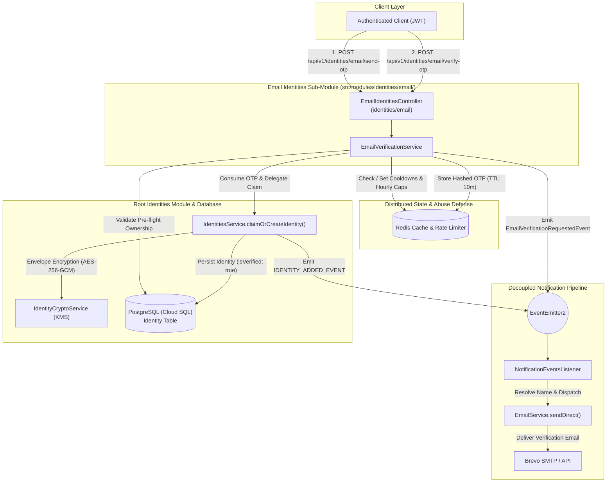
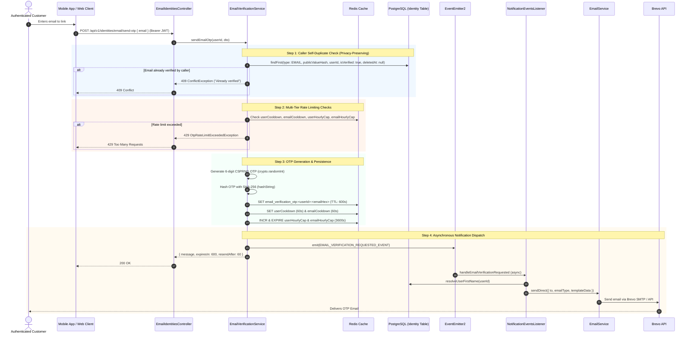
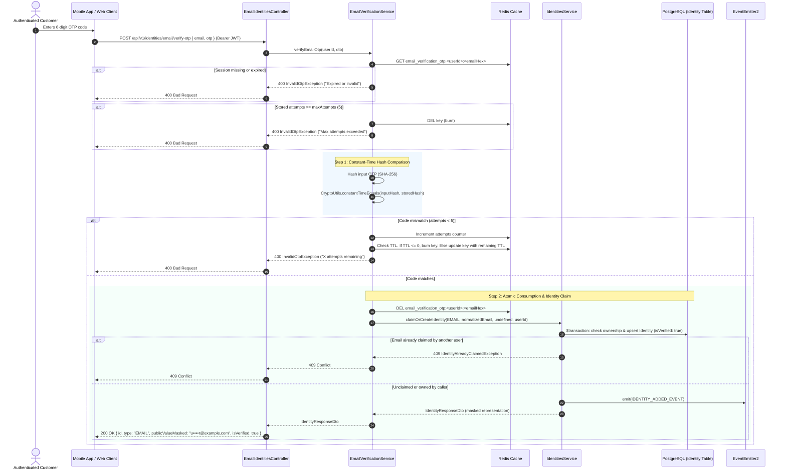

# Email Identities Module

The `EmailIdentitiesModule` (`src/modules/identities/email/`) is a dedicated sub-module of `IdentitiesModule` that manages in-house email one-time password (OTP) verification and links verified email addresses directly to customer accounts as `Identity` records.

---

## 📋 Purpose & Business Motivation

In the BreathAway platform, authenticated customers can sign in using their phone number or OAuth providers and may wish to link multiple email addresses (e.g. personal, work, secondary) to their account for discovery, matching, and transactional communications.

### Why In-House OTP Instead of Firebase Authentication?

1. **Avoiding Account Duplication**: Firebase Authentication creates a separate user account (`UserRecord`) for each email address registered. Registering secondary or auxiliary emails via Firebase would result in fragmented, duplicate user entities in Firebase Auth that are disconnected from the customer's primary account.
2. **Identity-Only Scope**: Secondary email addresses are purely for contactability, identity discovery, and matching. They are **not** login credentials (`AuthCredential`).
3. **Decoupled Delivery**: Leverages BreathAway's existing Brevo transactional email infrastructure, allowing custom Handlebars templates (`email-verification-otp.hbs`) and unified brand messaging.
4. **Zero Database Migrations**: Seamlessly reuses PostgreSQL's existing `Identity` schema (`type = 'EMAIL'`, deterministic HMAC-SHA256 indexing via `publicValueHash`, and envelope encryption).

---

## 🏗 System Architecture

The following diagram illustrates how the `EmailIdentitiesModule` coordinates with Redis for OTP state, emits domain events to the decoupled notification system for email dispatch, and delegates to `IdentitiesService` for database persistence:



---

## 🔄 Sequence Diagrams

### 1. Requesting Email Verification OTP (`POST /api/v1/identities/email/send-otp`)



---

### 2. Verifying OTP & Claiming Identity (`POST /api/v1/identities/email/verify-otp`)



---

## 🛡 Security & Abuse Protection Invariants

The `EmailVerificationService` enforces defense-in-depth across five security layers:

### 1. Multi-Tier Rate Limiting

- **User Cooldown**: Enforces a 60-second cooldown per authenticated user (`rate_limit:email_otp:user:<userId>`).
- **Email Cooldown**: Enforces a 60-second cooldown per target email address hash (`rate_limit:email_otp:email:<emailHex>`).
- **User Hourly Cap**: Limits an individual user to a maximum of 5 OTP requests per hour (`rate_limit:email_otp:hourly:<userId>`).
- **Email Hourly Cap**: Limits any individual email address to a maximum of 5 OTP requests per hour across all accounts (`rate_limit:email_otp:hourly:email:<emailHex>`). This protects third-party victim inboxes from distributed harassment attacks where an adversary rotates multiple accounts.
- **Zombie Key Prevention**: After executing Redis `INCR`, the service inspects key TTL. If the key was created without an expiration (`TTL = -1`), it automatically sets a 3,600-second TTL.

### 2. Cryptographic Security & High Entropy

- **CSPRNG Generation**: OTPs are generated using Node.js `crypto.randomInt(100000, 1000000)` providing $10^6$ equiprobable combinations.
- **Hashed Redis Storage**: Plain OTPs are never stored in Redis. Only deterministic SHA-256 digests (`hashString(plainOtp)`) are persisted.
- **Constant-Time Verification**: Verification digests are compared in constant time via `CryptoUtils.constantTimeEquals(bufA, bufB)`, preventing timing side-channel attacks.

### 3. Brute-Force & Replay Defenses

- **Maximum Attempt Threshold**: A single OTP allows a maximum of 5 attempts.
- **Atomic Burning**: If 5 failed attempts occur, or if an expired OTP is checked, the Redis key is burned immediately (`redisService.del`).
- **TTL Resurrect Guard**: When decrementing attempts on mismatch, if the remaining key TTL is $\le 0$, the session is immediately burned rather than resetting the TTL.

### 4. PII Redaction in Structured Logs

In compliance with GDPR and project logging standards (`AGENTS.md`), customer email addresses are never logged in plaintext. The service logs masked strings (e.g. `t••••t@example.com`) or HMAC hex digests (`emailHex`) in all operational log metadata.

---

## 📬 Decoupled Notification Integration

In adherence to the **Decoupled Notifications Golden Rule**:

- The `EmailVerificationService` **never** imports `NotificationsModule` or injects `NotificationsService`.
- Upon successful OTP generation, it emits `EmailVerificationRequestedEvent(userId, email, otp, expiresInSeconds)`.
- The central [`NotificationEventsListener`](file:///Users/mohitmalpani/Business/BreathAway/Backend/breathaway/src/modules/notifications/listeners/notification-events.listener.ts) intercepts the event asynchronously (`@OnEvent(..., { async: true })`), resolves the user's first name, and invokes [`EmailService.sendDirect()`](file:///Users/mohitmalpani/Business/BreathAway/Backend/breathaway/src/modules/notifications/email/email.service.ts).
- `EmailService.renderAndSend` compiles [`email-verification-otp.hbs`](file:///Users/mohitmalpani/Business/BreathAway/Backend/breathaway/src/modules/notifications/templates/email-verification-otp.hbs), auto-merges layout defaults (`appUrl`, `currentYear`), and delivers the message via Brevo.

---

## 🛠 API Endpoints Specification

### 1. Request OTP

- **Route**: `POST /api/v1/identities/email/send-otp`
- **Auth**: `Bearer <JWT>`
- **Throttle**: Strict (`AUTH_STRICT_THROTTLE`)
- **Request Body**:
  ```json
  {
    "email": "personal.email@example.com"
  }
  ```
- **Success Response (200 OK)**:
  ```json
  {
    "message": "Verification code sent to email",
    "expiresIn": 600,
    "resendAfter": 60
  }
  ```
- **Error Responses**:
  - `400 Bad Request`: Validation failure (malformed email).
  - `409 Conflict`: Email already verified and linked to the caller's own account (cross-account ownership is intentionally not disclosed here to prevent account enumeration).
  - `429 Too Many Requests`: Cooldown active or hourly cap exceeded.

### 2. Verify OTP & Link Identity

- **Route**: `POST /api/v1/identities/email/verify-otp`
- **Auth**: `Bearer <JWT>`
- **Throttle**: Strict (`AUTH_STRICT_THROTTLE`)
- **Request Body**:
  ```json
  {
    "email": "personal.email@example.com",
    "otp": "482910"
  }
  ```
- **Success Response (200 OK)**:
  ```json
  {
    "id": "01JCARB5G6H7J8K9L0MNPQRSTU",
    "type": "EMAIL",
    "publicValueMasked": "p••••l@example.com",
    "isVerified": true,
    "verifiedAt": "2026-11-07T17:30:00.000Z",
    "createdAt": "2026-11-07T17:30:00.000Z",
    "userId": "user-uuid"
  }
  ```
- **Error Responses**:
  - `400 Bad Request`: Code expired, invalid OTP, or maximum attempts exceeded.
  - `409 Conflict`: Email is already claimed by another user.
  - `429 Too Many Requests`: Rate limit exceeded.

---

## 📁 Source Code Organization

```
src/modules/identities/email/
├── dto/
│   ├── request/
│   │   ├── send-email-otp.request.dto.ts      # Validates email formatting and normalization
│   │   └── verify-email-otp.request.dto.ts    # Validates 6-digit numeric OTP code
│   ├── response/
│   │   └── send-email-otp.response.dto.ts     # Expiration and resend durations
│   └── index.ts                               # Barrel export
├── tests/
│   ├── email-identities.controller.spec.ts    # Controller route and DTO unit tests
│   └── email-verification.service.spec.ts     # Complete lifecycle, rate-limiting & security tests
├── email-identities.controller.ts             # REST controller mounted at identities/email
├── email-identities.module.ts                 # Sub-module definition (forwardRef to IdentitiesModule)
└── email-verification.service.ts              # Core OTP generation, Redis state, and claim coordination
```
