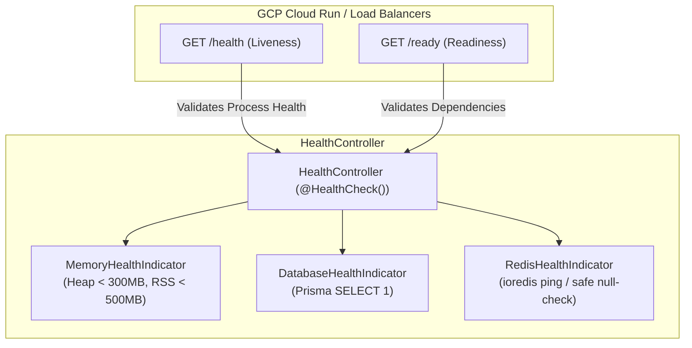

# Health Module

The `HealthModule` uses NestJS `@nestjs/terminus` to verify the operational state of the backend service and its dependencies, providing differentiated liveness and readiness probes for Google Cloud Run and Kubernetes load balancers.

---

## 📋 Purpose & Responsibilities

- **Liveness Probing (`/health`)**: Fast, non-blocking check validating that the Node.js event loop is spinning and heap/RSS memory usage remains within configured thresholds. It deliberately avoids calling downstream database or cache services so that transient downstream blips do not cause orchestrators to terminate healthy containers.
- **Readiness Probing (`/ready`)**: Traffic admission check verifying PostgreSQL database and Redis cache connectivity before Cloud Run routes production traffic to the container revision.
- **Stateless Cloud Run Architecture**: Bypasses mobile client identity headers via `@SkipClientIdentity()`, allowing GCP infrastructure health checks to execute without credentials.

---

## 🧠 Business Logic & Core Concepts

### 1. Differentiated Probing Strategy

#### A. Liveness Probe (`GET /health`)
- **Memory (Heap)**: Ensures Node.js V8 heap usage is under 300MB.
- **Memory (RSS)**: Ensures Resident Set Size is under 500MB.
- **Result**: Responds with HTTP `200 OK` and `{ status: 'ok', info: { memory_heap: { status: 'up' }, memory_rss: { status: 'up' } } }`.

#### B. Readiness Probe (`GET /ready`)
- **Database (`DatabaseHealthIndicator`)**: Executes a lightweight `SELECT 1` query via `PrismaService` to verify the PostgreSQL connection pool is ready and accepting queries.
- **Cache (`RedisHealthIndicator`)**: Pings Redis via the global `REDIS_CLIENT`. If Redis is unconfigured (`REDIS_URL` omitted), it safely reports `up` with `{ enabled: false }` rather than failing the readiness probe in dev/staging environments.
- **Result**: Returns HTTP `200 OK` if all dependencies are healthy, or `503 Service Unavailable` if PostgreSQL or Redis is degraded.

---

## 🛠 File & Class Definitions

### Controller
- **[HealthController](file:///Users/mohitmalpani/Business/BreathAway/Backend/breathaway/src/modules/health/health.controller.ts)**:
  - `@SkipClientIdentity()`: Bypasses mobile device and app-version verification headers.
  - `@Get('health')`: Liveness probe.
  - `@Get('ready')`: Readiness probe.

### Indicators
- **[DatabaseHealthIndicator](file:///Users/mohitmalpani/Business/BreathAway/Backend/breathaway/src/modules/health/indicators/database.health.ts)**: Verifies PostgreSQL responsiveness via Prisma.
- **[RedisHealthIndicator](file:///Users/mohitmalpani/Business/BreathAway/Backend/breathaway/src/modules/health/indicators/redis.health.ts)**: Verifies Redis responsiveness with null-safe handling.

---

## 🔄 Public APIs

| Route | Method | Purpose | Success Status | Failure Status |
| :--- | :--- | :--- | :--- | :--- |
| `/health` | `GET` | Container liveness (Memory & event loop) | `200 OK` | `503 Service Unavailable` |
| `/ready` | `GET` | Traffic readiness (Database & Redis) | `200 OK` | `503 Service Unavailable` |
