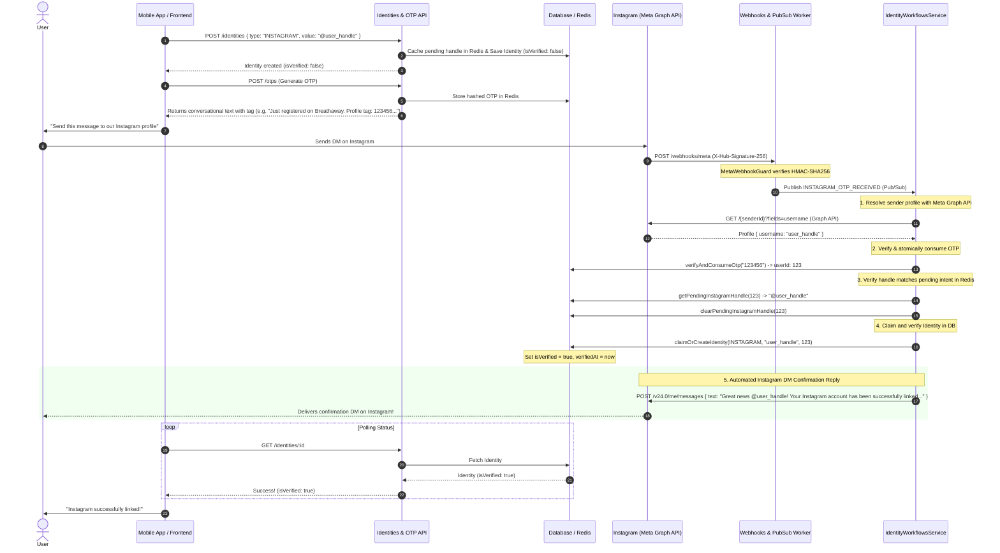

# Identity Workflows Module

The `IdentityWorkflowsModule` orchestrates progressive onboarding and identity validation workflows, coordinating verification steps across multiple features.

---

## 📋 Purpose & Responsibilities

- **Progressive Onboarding**: Guides users through account setup states (such as verifying a phone OTP, linking Instagram, and creating a profile).
- **Workflow State Management**: Directs validation checks and registers progress indicators in the database to prevent incomplete registrations.
- **Asymmetric Auto-Replies**: Sends immediate, conversational confirmation direct messages on third-party platforms (like Instagram) upon successful identity verification.

---

## 🧠 Business Logic & Core Concepts

### 1. Retroactive Match Resolution (Ghost Identities)

When an `IDENTITY_CLAIMED` event fires, the `handleIdentityClaimed` listener scans for all `PENDING` likes that targeted the newly claimed identity. It iterates over these actionable likes and runs them through the `MatchResolverService`. This logic is what converts pending "ghost" interactions into mutual matches the moment a user finishes onboarding.

### 2. Cross-Channel OTP Verification & Failure Resilience

The Instagram verification flow (`handleInstagramOtpReceived`) bridges SMS/Email logic with Instagram DMs. To guarantee resilience against external API outages and preserve user experience:

- **Third-Party Resolution First**: Calls Meta Graph API (`verifyInstagramIdentity(null, senderId)`) **before** consuming the user's OTP. If Meta's Graph API is temporarily degraded or errors, the user's OTP is untouched, allowing them to retry without losing their code.
- **Atomic Single-Use Consumption**: Validates and deletes the OTP from Redis via `verifyAndConsumeOtp`.
- **Handle Intent Integrity**: Verifies that the Instagram handle resolved from Meta matches the pending handle the user entered in the app (`identitiesService.getPendingInstagramHandle`). On mismatch, the pending handle is immediately cleared to prevent stale state, and a push notification is dispatched explaining the mismatch.
- **Automated Natural Language DM Confirmation**: Dispatches an immediate confirmation direct message back to the user's Instagram account via `InstagramService.sendDirectMessage`, synthesized using `InstagramVerificationResponseGenerator`.
- **Non-Blocking Notifications**: Notification dispatches and DM replies use fire-and-forget `.catch()` handlers with contextual error logging, ensuring notification delivery hiccups do not abort successful database identity claims.

---

## 📸 Instagram Identity Verification Flow

This workflow verifies ownership of a user's Instagram handle using an out-of-band message check via Webhooks, high-entropy natural language OTP messages, and automated confirmation DMs.

### Step-by-Step Breakdown

#### 1. Identity Registration (Pending State)

- **Action**: The client app calls `POST /identities`.
- **Payload**: Sends `type` as `INSTAGRAM` and `publicValue` as the customer's Instagram Handle (e.g. `@johndoe`).
- **Backend Result**: The `IdentitiesService` caches the pending handle in Redis (`pending_ig_handle:<userId>`) and creates/links an unverified `Identity` record in the database (`isVerified: false`).

#### 2. Organic OTP Message Generation

- **Action**: The client requests a new OTP via `POST /api/v1/otps`.
- **Backend Result**: The backend generates a secure slug OTP and synthesizes an organic, conversational message via `OtpMessageGenerator` (e.g. `"Just registered on Breathaway. Here is my profile tag: 123456. Looking forward to getting started!"`).
- **Anti-Spam Invariant**: The synthesized copy strictly avoids trigger terms (`verify`, `verification`, `verified`, `code`, `app`) to ensure the user's DM never trips Meta's automated spam or bot detection filters.

#### 3. User Action

- **Action**: The client presents the user with a pre-filled button to open Instagram and send the conversational message to BreathAway's official Instagram account.
- **User Action**: The user sends the DM on Instagram.

#### 4. Webhook Ingress & Cryptographic Guard

- **Action**: Meta delivers an incoming messaging webhook event (`POST /api/v1/webhooks/meta`).
- **Backend Result**:
  1. `MetaWebhookGuard` validates the `X-Hub-Signature-256` HMAC-SHA256 digest against `META_APP_SECRET`.
  2. The webhook parser extracts the message payload and dispatches `INSTAGRAM_OTP_RECEIVED` over GCP Pub/Sub.

#### 5. Identity Verification, Claiming & Auto-Reply

- **Action**: `IdentityWorkflowsService.handleInstagramOtpReceived` processes the Pub/Sub event:
  1. **Graph API Sender Resolution**: Queries Meta Graph API to resolve the sender's Instagram profile (`id`, `username`).
  2. **Atomic OTP Consumption**: Validates and consumes the extracted OTP in Redis, retrieving the initiating `userId`.
  3. **Handle Mismatch Guard**: Compares the sender's actual Instagram handle against the pending handle cached in Redis. If they do not match, the pending handle is cleared and a failure push notification is dispatched.
  4. **Claim Database Identity**: Calls `identitiesService.claimOrCreateIdentity`, setting `isVerified = true` and updating `verifiedAt`.
  5. **Automated Instagram DM Confirmation**: Dispatches an immediate confirmation direct message back to the sender on Instagram via `InstagramService.sendDirectMessage` using natural language generated by `InstagramVerificationResponseGenerator` (e.g. `"Great news @johndoe! Your profile connection is complete and confirmed. Have a wonderful time! 🎉"`).
  6. **Push Notification**: Fires a push notification to the user's mobile device confirming the linkage.

#### 6. Client Polling (Completion)

- **Action**: Meanwhile, the client polls `GET /identities/:id`.
- **Backend Result**: Returns `isVerified: true`. The client dismisses the verification modal and unlocks Instagram-verified features.

---

## 🔄 Sequence Diagram

