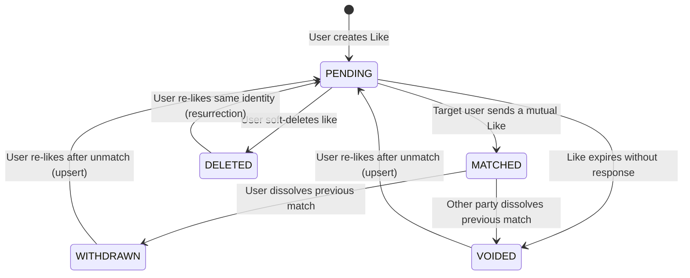

# Likes Module

The `LikesModule` manages liking mechanics, capturing user intents, and executing state transitions for outbound connection requests.

---

## 📋 Purpose & Responsibilities

- **Liking Mechanics**: Persists connection intents from one user to another's identity.
- **Pre-Flight Validation**: Provides `POST /likes/can-create` to evaluate match/like eligibility instantly without executing DB transactions or consuming credits.
- **Instant Match Handshake**: Resolves mutual interest synchronously during like creation by default, returning `status: "MATCHED"` and `matchId` immediately without client polling or guesswork, with an optional `?async=true` parameter for fire-and-forget background execution.
- **Relational Intent Capturing**: Tracks the specific dating/connection intents of the sender to ensure mutual compatibility checks.
- **Credit Deductions Integration**: Integrates with the `CreditsModule` to deduct credit balances for specific actions (such as sending a super-like).
- **Idempotent Re-Liking & Soft-Delete Resurrection**: Seamlessly handles re-liking previously deleted, withdrawn, or voided likes by updating the existing record back to `PENDING` rather than inserting a duplicate row or throwing a unique constraint conflict.

---

## 🔄 End-to-End Like Creation Workflow

The following sequence diagram illustrates the end-to-end execution path when a client issues a `POST /api/v1/likes` request, as implemented across `LikesController` and `LikesService`.

```mermaid
sequenceDiagram
    autonumber
    actor Client as Mobile Client
    participant Controller as LikesController
    participant Service as LikesService
    participant Credits as CreditsService
    participant Identities as IdentitiesService
    participant Crypto as IdentityCryptoService
    participant DB as PrismaService / Cloud SQL
    participant Resolver as MatchResolverService
    participant Audit as AuditModule

    Client->>Controller: POST /api/v1/likes?async=false (DTO, x-timezone)
    Note over Controller: JwtAuthGuard validates token (userId)<br/>RequireTimezoneGuard extracts req.timezone<br/>CreateLikeQueryDto parses optional ?async
    Controller->>Service: create(userId, dto, timezone, isAsync)

    rect rgb(240, 248, 255)
    Note over Service, Credits: Phase 1: Pre-Flight Credit Verification
    Service->>Credits: hasSufficientCredits(userId, CREDITS_PER_LIKE)
    Credits-->>Service: boolean
    alt Insufficient Credits
        Service->>Audit: emitAuditLog(USAGE_DENIED)
        Service-->>Controller: throw InsufficientCreditsException (400)
        Controller-->>Client: 400 Bad Request (Insufficient credits)
    end
    end

    rect rgb(255, 250, 240)
    Note over Service, Crypto: Phase 2: Target Identity Resolution
    alt Raw targetIdentity provided (without targetIdentityId)
        opt Phone Number without Country Code
            Service->>Identities: getSenderCountryCode(userId)
            Identities-->>Service: senderCountryCode
            Service->>Service: Prepend country code to E.164 format
        end
        Service->>Crypto: processPublicValue(resolvedValue, type)
        Crypto-->>Service: { publicValueHash, encryptedPublicValue }
        Service->>DB: identity.findUnique({ type, publicValueHash })
        alt Identity Found
            DB-->>Service: existing targetIdentityId
        else Identity Not Found (Ghost Identity)
            Service->>DB: identity.create(userId: null, isVerified: false, ...)
            DB-->>Service: new unresolved targetIdentityId
        end
    end
    end

    rect rgb(245, 255, 250)
    Note over Service, DB: Phase 3: Identity & Self-Like Validation
    Service->>DB: identity.findUnique({ id: targetIdentityId })
    alt Target Identity Does Not Exist
        Service-->>Controller: throw IdentityNotFoundException (404)
    else Target Belongs to Sender (targetIdentity.userId === userId)
        Service-->>Controller: throw SelfLikeException (400)
    end
    end

    rect rgb(255, 245, 245)
    Note over Service, DB: Phase 4: Duplicate & Active Match Pre-Flight Guards
    Service->>DB: like.findFirst(senderUserId, targetIdentityId, status: PENDING)
    opt Active PENDING Like Already Exists
        Service-->>Controller: throw AlreadyLikedException (409)
    end
    Service->>DB: like.findFirst(status IN [WITHDRAWN, VOIDED, DELETED] OR deletedAt != null)
    Note over Service: Identifies reusable row to resurrect instead of creating duplicate
    opt Target Identity has an Associated Registered User
        Service->>DB: match.findUnique(userOneId, userTwoId, status: ACTIVE)
        opt Active Match Already Exists
            Service-->>Controller: throw AlreadyMatchedException (409)
        end
    end
    end

    rect rgb(240, 255, 240)
    Note over Service, DB: Phase 5: Atomic Persistence & Credit Deduction ($transaction)
    opt Personal Label Provided
        Service->>Crypto: encryptText(dto.label)
        Crypto-->>Service: encryptedLabel (enc:v1:...)
    end
    Service->>DB: $transaction(async tx => ...)
    alt Reusable Like Row Exists (Resurrection)
        Service->>DB: tx.like.update(status: PENDING, deletedAt: null, expiresAt, intent, label: encryptedLabel)
    else Fresh Like
        Service->>DB: tx.like.create(senderUserId, targetIdentityId, status: PENDING, expiresAt, label: encryptedLabel)
    end
    Service->>Credits: consumeCredits({ userId, amount: CREDITS_PER_LIKE, referenceId: like.id }, tx)
    Credits->>DB: tx.creditLedgerEntry.create(...) + tx.creditAccount.update(...)
    DB-->>Service: Transaction Committed (Persisted Like)
    end

    rect rgb(255, 240, 255)
    Note over Service, Resolver: Phase 6: Mutual Match Resolution (Dual-Mode Handshake)
    alt Synchronous Resolution (Default: async = false)
        Service->>Resolver: await resolveFromLike(like)
        Note over Resolver, DB: Checks target user for reciprocal like, intent compatibility, and blocks.<br/>If mutual, updates both Likes to MATCHED and atomically creates Match.
        Resolver-->>Service: Match record (or null if no match)
        opt Match Formed
            Service->>Service: status = MATCHED, matchId = match.id
        end
    else Fire-and-Forget Background Mode (?async=true)
        Service->)Resolver: resolveFromLike(like) (Unawaited background task)
        Note over Service: Returns immediately with status: PENDING, matchId: null
    end
    end

    rect rgb(245, 245, 255)
    Note over Service, Client: Phase 7: Audit Logging & Decrypted Response Hydration
    Service->>Audit: emitAuditLog(LIKE_CREATED)
    par Parallel Field Decryption
        Service->>Identities: getDecryptedPublicValue(targetIdentityId)
        Identities-->>Service: decrypted publicValue
    and
        Service->>Crypto: decryptText(like.label)
        Crypto-->>Service: decrypted label
    end
    Service-->>Controller: Hydrated Like with targetIdentity, decrypted label, status, and matchId
    Controller-->>Client: 201 Created (LikeResponseDto with matchId)
    end
```

### Key Execution Phases Explained

1. **Guard Execution**: `JwtAuthGuard` validates the caller's JWT token and extracts the authenticated `userId`. `RequireTimezoneGuard` extracts and validates the client's `x-timezone` header, attaching it to `req.timezone` to compute accurate midnight expiration dates. `CreateLikeQueryDto` extracts the optional `?async` boolean query parameter (default `false`).
2. **Phase 1 (Credit Pre-Check)**: Before performing database queries or mutations, `CreditsService.hasSufficientCredits` ensures the user possesses at least `CREDITS_PER_LIKE` credits. If insufficient, an audit log (`USAGE_DENIED`) is recorded and `InsufficientCreditsException` is thrown.
3. **Phase 2 (Target Identity Resolution)**: If the client passed raw identity details (`targetIdentity`) rather than a known UUID, phone numbers are normalized to E.164 (using the caller's verified country code if omitted). SHA-256 hashing and AES-256 envelope encryption are performed by `IdentityCryptoService`. If no matching row exists, an unresolved "Ghost Identity" (`userId = null`) is created so intent can be registered even before the target registers.
4. **Phase 3 (Identity & Self-Like Validation)**: Verifies the target identity exists and ensures `targetIdentity.userId !== userId` (self-liking is rejected with `SelfLikeException`).
5. **Phase 4 (Duplicate & Active Match Pre-Flight Guards)**:
   - Rejects existing active `PENDING` likes with `AlreadyLikedException`.
   - Checks for reusable soft-deleted, withdrawn, or voided rows to prepare for resurrection.
   - Verifies whether an `ACTIVE` match already exists between the two users, aborting with `AlreadyMatchedException` before any credits are deducted.
6. **Phase 5 (Atomic Transaction & Label Envelope Encryption)**: If the client passed an optional personal `label`, `LikesService` encrypts it via `IdentityCryptoService.encryptText()` using AES-256-GCM envelope encryption wrapped by GCP Cloud KMS before persisting. Inside a Prisma `$transaction`:
   - Either updates an existing inactive row back to `PENDING` (preserving row ID and audit trail) or inserts a new row with the encrypted ciphertext.
   - Atomically deducts credits via `CreditsService.consumeCredits`, appending an immutable ledger entry.
7. **Phase 6 (Dual-Mode Match Resolution)**:
   - **Synchronous Handshake (Default)**: `LikesService.create()` synchronously awaits `MatchResolverService.resolveFromLike()`. If the counterpart has already liked this user with compatible intent, the resolver creates/reactivates the `Match`, marks both likes as `MATCHED`, and returns the `Match` record. `LikesService` sets `status: MATCHED` and populates `matchId: match.id`. If no reciprocal like exists, it returns `status: PENDING` and `matchId: null`.
   - **Asynchronous Execution (`?async=true`)**: The resolver is dispatched as an unawaited background task, immediately returning `status: PENDING` and `matchId: null`.
   - **Decoupled Notifications**: In both modes, downstream notifications (push, email, WhatsApp) are dispatched asynchronously out-of-band via `@OnEvent(MATCH_CREATED_EVENT, { async: true })`, ensuring notification delivery latency never impacts the client.
8. **Phase 7 (Response Hydration & Audit)**: Emits `LIKE_CREATED` audit event, concurrently decrypts the target identity's `publicValue` via `IdentitiesService` and the personal `label` via `IdentityCryptoService.decryptText()`, and returns `LikeResponseDto` (including `matchId: string | null`) with HTTP 201.

---

## 🧠 Business Logic & Core Concepts

### 1. Atomic Credit Consumption

Sending a like is a premium action. The `LikesService` performs a pre-check for sufficient credits. When persisting the like, it uses a database transaction (`$transaction`) to atomically create the `Like` record and deduct the required credits via the `CreditsService`. If the user lacks credits, the system emits a `USAGE_DENIED` audit event.

### 2. "Ghost" Identity Target Resolution

In BreathAway, users do not just like other _users_; they like _target identities_ (e.g., an Instagram handle or a phone number).

- If the target identity is already registered to a user, the like targets them directly.
- If the target identity **does not exist**, the system creates an _unresolved_ "Ghost Identity" (`userId = null`). This allows users to express intent toward someone who hasn't joined the platform yet. When that person eventually registers, the Auth module claims this ghost identity and triggers retroactive matching.

### 3. Identity and Active Match Duplicate Prevention

When a user likes a target identity that resolves to an existing user profile (e.g., liking a user's phone number after already matching via their Instagram handle), the system verifies whether an `ACTIVE` match already exists between the two users.

- If an active match is found, the system explicitly aborts the transaction by throwing an `AlreadyMatchedException`.
- This early termination occurs **before** the credit consumption transaction begins, preventing unwarranted credit deductions and keeping the DB clean from duplicate likes tied to alternative identities.

**Pre-Flight API**: Clients can utilize the `POST /likes/can-create` endpoint with a target identity to verify eligibility beforehand. This avoids surprising the user with a failed transaction and enables smoother UI flows (like disabling the "Like" button in advance).

### 4. Re-Liking & Soft-Deleted Like Resurrection (Upsert Semantics)

The database schema enforces a unique constraint `@@unique([senderUserId, targetIdentityId])`, ensuring that only one like record can ever exist for a given sender-and-target-identity pair.

When a user deletes a pending like (`DELETE /api/v1/likes/:id`), the record is soft-deleted for auditability:

- Status transitions to `DELETED`.
- `deletedAt` is stamped with the current timestamp.

If the user subsequently attempts to like the same identity again:

- **No 409 Conflict**: Instead of attempting to insert a new row and failing with a database unique constraint violation (`409 Conflict: A record with this value already exists.`), the system identifies the existing inactive record (`DELETED`, `WITHDRAWN`, or `VOIDED`).
- **Resurrection back to `PENDING`**: Within the atomic `$transaction`, the service updates the existing record:
  - Resets `status` to `PENDING`.
  - Clears `deletedAt` back to `null`.
  - Refreshes `expiresAt` based on the current time and caller timezone.
  - Updates `intent` and optional personal `label`.
- **Full Operational Parity**: The resurrected like executes all standard liking operations:
  1. Verifies and deducts user credits atomically via `CreditsService.consumeCredits`.
  2. Emits a `LIKE_CREATED` audit log.
  3. Dispatches mutual match resolution (synchronously by default, or asynchronously if `?async=true`) via `MatchResolverService.resolveFromLike`.
- **Pre-Flight Validation**: The `POST /api/v1/likes/can-create` endpoint recognizes soft-deleted records as re-likable, returning `{ canCreate: true }` as long as no active match exists and the user is not liking themselves.

### 5. Instant Match Handshake & Dual-Mode Resolution

Mutual match resolution supports two operational modes controlled by the `?async` query parameter:

#### Synchronous Handshake (Default: `?async=false` or omitted)

When User A likes User B, and User B has already liked User A, the client needs to transition the user directly to the new match screen (`/matches/:matchId`). Previously, clients had to snapshot and diff `/api/v1/matches` before and after liking to deduce which match was created, introducing extra round trips and race conditions when multiple matches land concurrently.

By default, `LikesService.create()` synchronously awaits `MatchResolverService.resolveFromLike()`:

- **When a match forms**: The like response payload immediately includes `status: "MATCHED"` and `matchId: "<match-id>"`. The client navigates directly to `/matches/:matchId` without additional round trips or guessing.
- **When no match forms**: The response returns `status: "PENDING"` and `matchId: null`.
- **Fault Isolation**: If match resolution encounters an unexpected failure, the like creation itself is not rolled back; the like remains safely persisted in `PENDING` status.

#### Fire-and-Forget Background Resolution (`?async=true`)

For background ingestion, batch processing, or swipe flows that do not require an immediate match response, clients can supply `POST /api/v1/likes?async=true`. In this mode, `resolveFromLike()` is dispatched asynchronously in the background without awaiting, returning `status: "PENDING"` and `matchId: null` immediately.

#### Decoupled Notification Guarantee

Even during synchronous match resolution, user notifications (Push, Email, WhatsApp) **never** block the HTTP response. Match notifications are dispatched out-of-band via `@OnEvent(MATCH_CREATED_EVENT, { async: true })`, ensuring external third-party communication APIs (FCM, SendGrid, Twilio) do not add latency to the like creation response.

### 6. Persistent Annotations (Labels) & Compact Envelope Encryption

Users can attach a personal string `label` to a like (e.g., "Sarah from the gym"). Business logic dictates that these labels can be updated at any time, even if the like transitions to a `MATCHED` or `VOIDED` state, allowing users to continually personalize their history.

#### 🛡 Security Threat Model & Side-Channel Mitigation

BreathAway implements end-to-end envelope encryption for all target identifiers in the `Identity` table (`publicValueCiphertext`, `publicValueWrappedKey`, etc.). However, if a user sends a like to an unverified phone number and sets `label = "Angela"`, storing this label in plaintext in the database would create a **severe cryptographic side-channel deanonymization vulnerability**:

- Anyone inspecting a database snapshot, analytical replica, or query log could link the target identity row directly to the person's real name.
- Under GDPR (Articles 6, 9, 14, and 32), storing unconsented third-party PII and romantic intent in plaintext constitutes an immediate compliance violation.

#### 🔐 Compact Envelope Encryption Format

To eliminate this risk, `LikesModule` never persists labels in plaintext. Instead, it utilizes `IdentityCryptoService.encryptText()`, which generates a fresh 256-bit ephemeral Data Encryption Key (DEK), wraps it via Google Cloud KMS, encrypts the label using AES-256-GCM, and serializes the result into a single compact string stored directly in PostgreSQL's `label` column:

```text
enc:v1:<keyId>:<ivBase64>:<tagBase64>:<wrappedKeyBase64>:<ciphertextBase64>
```

| Segment              | Description                                                    |
| :------------------- | :------------------------------------------------------------- |
| `enc`                | Canonical schema indicator marking field-level encryption.     |
| `v1`                 | Cryptographic scheme version for future cipher rotation.       |
| `<keyId>`            | KMS master key identifier used to wrap the ephemeral data key. |
| `<ivBase64>`         | 12-byte initialization vector (Base64-encoded).                |
| `<tagBase64>`        | 16-byte GCM authentication tag verifying ciphertext integrity. |
| `<wrappedKeyBase64>` | AES-256 data key wrapped (encrypted) by GCP KMS.               |
| `<ciphertextBase64>` | AES-256-GCM encrypted label payload.                           |

#### ⚡ Strict Encryption Enforcement & Decryption Flow

- **Strict Format Enforcement**: Any non-null string stored in `label` must match the `enc:v1:` prefix. Legacy or unencrypted strings are strictly rejected by `IdentityCryptoService.decryptText()` (logging a security warning and returning `null`), guaranteeing that unencrypted text is never exposed.
- **On-the-Fly Decryption**: When returning likes to the client (`POST /api/v1/likes`, `GET /api/v1/likes`, `GET /api/v1/likes/:id`, `PATCH /api/v1/likes/:id/label`), `LikesService.attachPublicValue` decrypts the label concurrently with the target identity.
- **Cross-Domain Match Decryption**: When a user views their matches (`GET /api/v1/matches`), `MatchesService` automatically decrypts `myLike.label` so the sender sees their personal note under `otherUser.label`.
- **Notification Sanitization**: `MatchResolverService` decrypts labels prior to emitting `MatchCreatedEvent`, providing clean plaintext names to downstream notification handlers while keeping the database 100% encrypted at rest.

---

## ⚙️ Managed Enums & States

The liking flow relies on two core enums:

### 1. IntentType

Defines the connection interest type selected by the sender:

- **`RELATIONSHIP`**: User is looking for long-term relationships.
- **`CASUAL`**: User is looking for casual dating or hangouts.
- **`OPEN`**: User is open to multiple connection models.

### 2. LikeStatus

Represents the state lifecycle of a liking record:



- **`PENDING`**: The like has been sent, and the target user has not yet liked back.
- **`MATCHED`**: A mutual like has been detected and resolved into an active Match.
- **`VOIDED`**: The like expired without a response, or was system-voided when the other party dissolved a previous match. Can transition back to `PENDING` on re-like.
- **`WITHDRAWN`**: The like was withdrawn when the user dissolved a previous match. Can transition back to `PENDING` on re-like.
- **`DELETED`**: The sender explicitly soft-deleted the pending like. If the user likes the same identity again, this row is resurrected back to `PENDING` rather than creating a duplicate or throwing a conflict.

---

## 📡 API Endpoints & Contract

### 1. Create a Like (`POST /api/v1/likes`)

- **Guards**: `JwtAuthGuard`, `RequireTimezoneGuard`
- **Query Parameters**:
  | Parameter | Type | Required | Default | Description |
  | :--- | :--- | :--- | :--- | :--- |
  | `async` | `boolean` | No | `false` | When `true`, executes match resolution asynchronously in the background. When `false` (default), resolves matches synchronously and populates `matchId` immediately. |
- **Headers**:
  - `Authorization: Bearer <access_token>`
  - `x-timezone: <IANA-Timezone>` (e.g. `America/New_York`, `Asia/Kolkata`)
- **Request Body (`CreateLikeRequestDto`)**:
  ```json
  {
    "targetIdentityId": "01J23C4D5E6F7G8H9J0K1L2M3N",
    "intent": "CASUAL",
    "label": "Coffee meetup"
  }
  ```
- **Response (`LikeResponseDto` - HTTP 201 Created)**:
  ```json
  {
    "id": "01M5F3E5DA9G9DMEM93V3K1T5F",
    "intent": "CASUAL",
    "status": "MATCHED",
    "label": "Coffee meetup",
    "targetIdentity": {
      "id": "01J23C4D5E6F7G8H9J0K1L2M3N",
      "type": "PHONE_NUMBER",
      "value": "+1234567890",
      "isVerified": true
    },
    "matchId": "01M5F3E5DA9G9DMEM93V3K1T5M",
    "expiresAt": "2026-10-25T04:00:00.000Z",
    "createdAt": "2026-10-24T00:30:00.000Z"
  }
  ```

> [!NOTE]
> `matchId` is populated with the match identifier (`string`) whenever `status` is `MATCHED`. If `status` is `PENDING`, `matchId` is `null`.

### 2. Check Like Eligibility (`POST /api/v1/likes/can-create`)

- **Guards**: `JwtAuthGuard`
- **Request Body (`CanCreateLikeRequestDto`)**:
  ```json
  {
    "targetIdentityId": "01J23C4D5E6F7G8H9J0K1L2M3N"
  }
  ```
- **Response (`CanCreateLikeResponseDto` - HTTP 200 OK)**:
  ```json
  {
    "canCreate": true,
    "reason": null
  }
  ```
