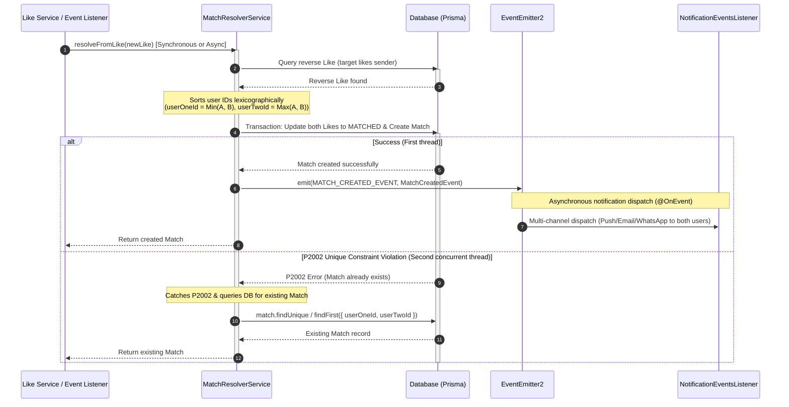

# Match Resolver Module

The `MatchResolverModule` is an internal background orchestrator responsible for identifying mutual interest, resolving active matches, and handling high-concurrency race conditions.

---

## 📋 Purpose & Responsibilities

- **Dual-Mode Pipeline Trigger**: Invoked immediately after a new `Like` record is written to the database (synchronously by default in `POST /api/v1/likes`, or asynchronously when `?async=true` or triggered via `IDENTITY_CLAIMED` domain events).
- **Mutual Interest & Compatibility Evaluation**: Searches for a reciprocal like (where the target user has liked the current sender), verifies intent compatibility (e.g. `RELATIONSHIP` vs `CASUAL`), and verifies that neither party has blocked the other.
- **Typed Match Return**: Returns `Promise<Match | null>` so caller services can immediately access the formed `Match.id` and pass it back in client responses.
- **Concurrency & Scaling**: Employs deterministic sorting and idempotent P2002 race handling to resolve simultaneous mutual likes without duplicate matches or transaction deadlocks.

---

## ⚙️ Concurrency & Race-Condition Design

When User A likes User B, and User B likes User A at the exact same millisecond, two parallel database queries will identify a mutual connection and attempt to create a `Match`. To prevent duplicate match records or transaction deadlocks, the module implements two architectural patterns:

### 1. Deterministic User ID Sorting

To guarantee that a match record between two users is unique, the database enforces a unique composite index on the columns `(userOneId, userTwoId)`.

When creating or querying a match, the service dynamically sorts the user IDs lexicographically:

- **`userOneId`**: Assigned to the lexicographically smaller User UUID/ULID string.
- **`userTwoId`**: Assigned to the lexicographically larger User UUID/ULID string.

This ensures that regardless of which user liked whom first, the database query always targets the same canonical row configuration.

### 2. Prisma P2002 Swallowing & Concurrent Match Recovery

If both users like each other simultaneously, the transactions will run concurrently:

1. Thread 1 updates User A's like to `MATCHED` and attempts to insert the `Match` record.
2. Thread 2 updates User B's like to `MATCHED` and attempts to insert the `Match` record.
3. Whichever thread finishes first successfully creates the `Match` and returns it.
4. The slower thread will fail with a Prisma unique constraint violation error (**`P2002`**) on the composite key `(userOneId, userTwoId)`.
5. The `MatchResolverService` explicitly catches the `P2002` error. Instead of failing or returning `null`, it queries the database for the existing `Match` record committed by Thread 1 and returns it. This guarantees that both concurrent callers receive the valid `Match` entity (and its `id`), preventing client errors while ensuring immediate access to `matchId`.

---

## 🔄 Match Resolution Flow

