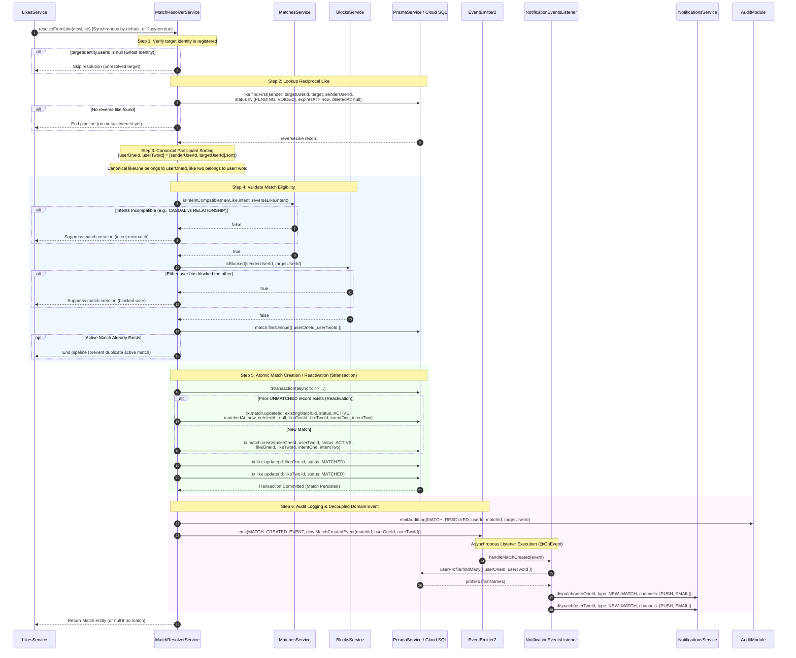
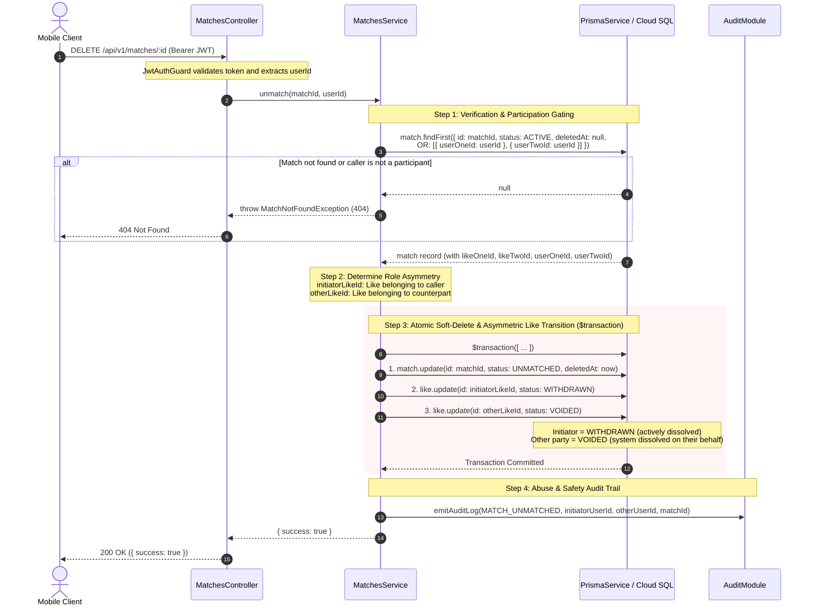
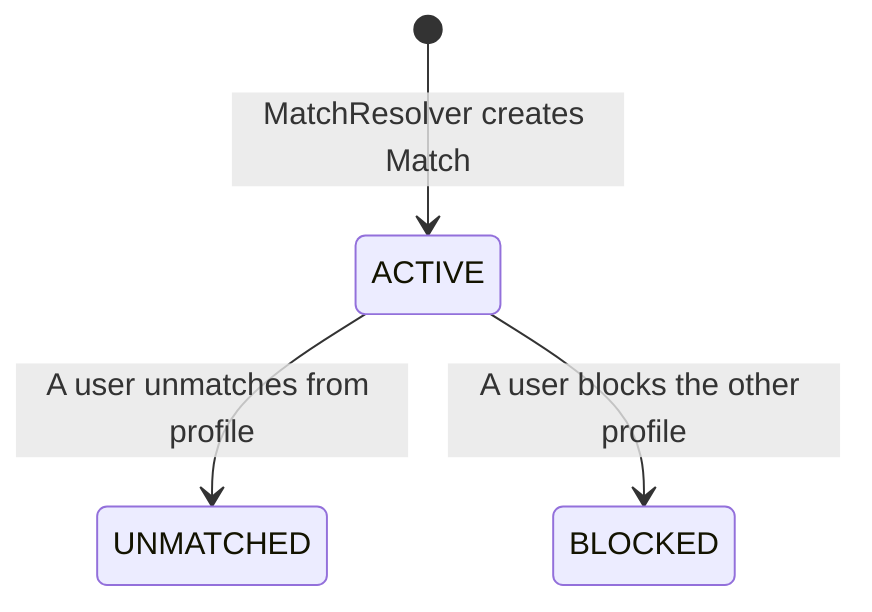

# Matches Module

The `MatchesModule` stores and tracks established, mutual connections between users, managing their state transitions and communication access rules.

---

## 📋 Purpose & Responsibilities

- **Match Tracking**: Persists mutual matches, recording the matching timestamp and both partners' initial intents.
- **Connection Lifecycle Management**: Updates match state parameters when users unmatch or block each other.
- **Access Authorization**: Acts as the gatekeeper for other communication systems (like Chats) to ensure a match is in an active state.

---

## 🔄 Core Workflows & Sequence Diagrams

The matching subsystem is orchestrated across two primary services:

1. **`MatchResolverService` (`src/modules/match-resolver`)**: The resolution engine triggered when a like is persisted, responsible for evaluating reciprocity, compatibility, and forging the `Match` record synchronously (by default, for instant client handshake) or asynchronously (in background or `?async=true` pipelines).
2. **`MatchesService` (`src/modules/matches`)**: Manages the lifecycle of active matches, queries, perspective normalisation, and connection dissolution (`unmatch`).

### 1. Match Resolution Pipeline (`MatchResolverService.resolveFromLike`)

This sequence executes when a like is created in `LikesService.create()`. By default, it runs synchronously to enable the client to receive `matchId` and `status: "MATCHED"` immediately upon like creation, eliminating client-side guessing. If the caller supplies `?async=true`, it runs outside the HTTP response path as an unawaited background task. In both cases, notification dispatch remains completely decoupled and asynchronous via `@OnEvent(MATCH_CREATED_EVENT, { async: true })`.

---

### 2. Unmatch & Connection Dissolution (`MatchesService.unmatch`)

When an authenticated user dissolves a match (`DELETE /api/v1/matches/:id`), the operation executes as an asymmetric atomic transaction:

---

## 🧠 Business Logic & Core Concepts

### 1. Intent Compatibility Matrix

A match is only forged if both users' connection intents align. The `MatchesService` enforces this via a strict matrix:

- **`OPEN`**: Highly permissive; matches with any other intent (`OPEN`, `RELATIONSHIP`, `CASUAL`).
- **`RELATIONSHIP`**: Strict; matches only with `RELATIONSHIP` or `OPEN`.
- **`CASUAL`**: Strict; matches only with `CASUAL` or `OPEN`.

### 2. Perspective Normalisation

Internally, the database stores participants arbitrarily as `userOne` and `userTwo`. However, when returning data to the client, the `MatchesService` dynamically remaps the payload into `me` and `otherUser` based on the caller's ID. This guarantees that frontend clients always consume the API from the first-person perspective without needing to check which user slot they occupy.

### 3. Unmatching & Abuse Auditing

Dissolving a connection (Unmatching) acts as a soft-delete (stamping `deletedAt` and transitioning status to `UNMATCHED`). When this occurs, the service emits a `MATCH_UNMATCHED` audit event containing both user IDs. This allows backend moderators to detect abuse patterns, such as "rematch cycling" (matching, unmatching, and matching again rapidly).

### 4. Match Label Fallback & Bounded KMS Concurrency

When users view their matches (`GET /api/v1/matches`), each match includes an `otherUser.label` representing how the caller identified their counterpart:

1. **Explicit Like Label**: If the user assigned a custom label when creating the like (e.g., `"Met at coffee shop"`), that value is returned directly.
2. **Encrypted Target Identity Fallback**: If `like.label` is empty or null, the system falls back to decrypting the target identity the caller originally swiped on (`targetIdentity.publicValue`), formatted appropriately:
   - **Phone Identities**: Formatted into readable international standard representation via `libphonenumber-js` (e.g. `+1 555 123 4567`).
   - **Social Identities**: Returns the decrypted username (e.g. `johndoe`).
3. **Bounded KMS Concurrency (`mapWithConcurrency`)**:
   - Decrypting identity envelope keys requires unwrapping data encryption keys via GCP Cloud KMS (`this.keyManager.unwrapDataKey`).
   - If an active user requests a page of 20 matches where likes lack explicit labels, an unbounded `Promise.all` would fire 20 parallel KMS RPC calls simultaneously, risking socket pool saturation and hitting GCP KMS quota thresholds.
   - To guard system stability, `findAllForUser` executes mappings through `mapWithConcurrency` with a fixed concurrency cap of 5 (`MAP_CONCURRENCY_LIMIT = 5`). This pools asynchronous KMS round-trips while preserving exact pagination ordering.
4. **Graceful Cryptographic Degradation**:
   - Decryption errors are captured and logged with canonical structured metadata (`err: serializeError(error)`).
   - If a single target identity cannot be decrypted (e.g. corrupt ciphertext), its label degrades gracefully to `null` without crashing the entire match list request.

---

## ⚙️ Managed Enums & States

The matching system manages records via the **`MatchStatus`** enum:

### Match States Reference

- **`ACTIVE`**:
  - **Description**: The connection is live and mutual.
  - **Permissions**: Both users can view each other's profiles and exchange messages in chat channels.
- **`UNMATCHED`**:
  - **Description**: One of the users explicitly broke the connection.
  - **Permissions**: Profile visibility is removed and messaging access is immediately revoked.
- **`BLOCKED`**:
  - **Description**: One of the users blocked the other.
  - **Permissions**: Restricts all interactions. The blocked profile cannot search for, view, or attempt to re-like the blocker.
