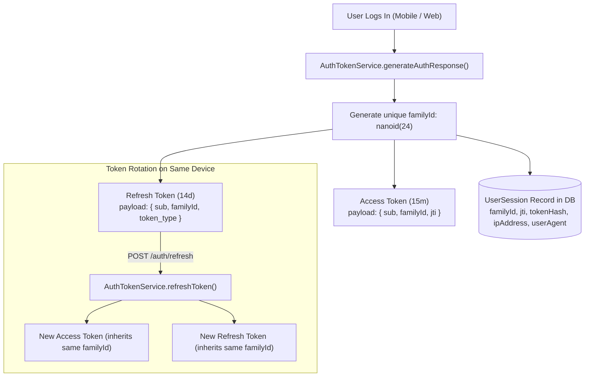

# Sessions Module

The `SessionsModule` provides user-facing APIs to inspect all currently active login sessions, correlate registered push devices, identify the caller's active device, and execute remote session terminations (single-session or all other sessions).

---

## 📋 Purpose & Responsibilities

- **Active Session Discovery (`GET /api/v1/sessions`)**: Retrieves all unexpired, non-revoked sessions from PostgreSQL `UserSession`, cross-referencing them against registered push tokens in `Device`.
- **Current Device Identification**: Resolves whether each session represents the caller's active device using the token lineage `familyId` (via `@CurrentFamilyId()`) and the `x-device-id` header.
- **Remote Targeted Revocation (`DELETE /api/v1/sessions/:id`)**: Terminates a specific active session by either its ULID or lineage `familyId`, logging that device out and deactivating its push notifications.
- **All-Other-Sessions Revocation (`DELETE /api/v1/sessions`)**: Terminates all active sessions for the user across all other devices while preserving the caller's current session.
- **Push Notification Cleanup**: Automatically marks corresponding `Device` records as `isActive: false` upon revocation to immediately halt push alert delivery to disconnected hardware.
- **Security Audit Trails**: Dispatches compliance audit logs (`AuditActionType.USER_LOGOUT`) recording revoked session IDs, family lineages, and client IP addresses.

---

## 🧠 Business Logic & Core Concepts

### 1. Dual-Token Lineage (`familyId`)

Every authenticated login chain begins with a unique 24-character session lineage identifier (`familyId`, generated via `nanoid(24)`).

- **Access Token**: Carries `{ sub: userId, familyId, jti }` with a 15-minute lifespan (`JWT_EXPIRES_IN`).
- **Refresh Token**: Carries `{ sub: userId, familyId, token_type: 'refresh' }` with a 14-day lifespan (`JWT_REFRESH_EXPIRES_IN`).
- **Rotation Lineage**: When the refresh token rotates, the new access and refresh token pair inherit the existing `familyId`.

This enables the backend to trace all requests from a single device across token rotations back to an overarching session family.



---

### 2. Device & Session Correlation

A user's presence consists of two complementary layers:

1. **`UserSession` (Stateful Login Session)**: Tracks credentials, IP addresses, browser/client User-Agent strings, and expiration timestamps.
2. **`Device` (Push Notification Target)**: Tracks FCM registration tokens, push activation status (`isActive`), hardware platform (`IOS`, `ANDROID`, `WEB`), and client app versions.

The `SessionsService` performs an $O(1)$ correlated join in memory:

- Fetches active `UserSession` records (`revokedAt: null, expiresAt > NOW()`).
- Fetches all registered `Device` records for the user.
- Correlates sessions and devices by `deviceId`.
- Enriches the session DTO with push status, hardware platform, operating system, and parsed browser details.

---

### 3. User-Agent Parsing & Client Metadata

The [`SessionMetadataParser`](file:///src/modules/sessions/utils/session-metadata.parser.ts) extracts clean, user-friendly device models and browser names from raw HTTP User-Agent strings across mobile, web, and API client environments:

| User-Agent Format                                              | Detected Platform | Device Model / Browser       |
| :------------------------------------------------------------- | :---------------- | :--------------------------- |
| `BreathAway/1.0.0 (iOS 17.5; iPhone15,2)`                      | `IOS`             | `iPhone15,2`, iOS 17.5       |
| `BreathAway/2.0.1 (Android 14; SM-S928B)`                      | `ANDROID`         | `SM-S928B`, Android 14       |
| `Mozilla/5.0 (Macintosh; Intel Mac OS X 10_15_7) Chrome/128.0` | `WEB`             | `Apple Macintosh` / `Chrome` |
| `node` (Web SSR / Next.js server runtime)                      | `WEB`             | `Node.js Server` / `Node.js` |
| `PostmanRuntime/7.39.0` (API Testing)                          | `WEB`             | `Postman Client` / `Postman` |

---

### 4. Tentative IP Geolocation Resolution

To provide users with meaningful context on where their account is being accessed from, `SessionsService` enriches active session records with tentative geographic location data resolved from `session.ipAddress` via `IpGeolocationService`:

- **Data Points**: City, administrative region/state, ISO 3166-1 alpha-2 country code, localized English country name (resolved via Node.js native `Intl.DisplayNames`), timezone, and a pre-formatted human-readable display string (e.g. `"Mumbai, India"`).
- **Sub-Millisecond Distributed Caching**: IP geolocations are cached in Redis (`ip:geo:<ip>`) with a 30-day TTL. Subsequent requests for the same IP address execute in sub-millisecond time and consume zero external API quota.
- **Deduplicated Parallel Resolution**: When a user holds multiple active sessions across the same IP address, distinct IP addresses are deduplicated and queried concurrently via `Promise.all`.
- **Private & Reserved IP Bypass**: Localhost, loopback (`127.0.0.1`, `::1`), RFC 1918 private subnets (`10.0.0.0/8`, `172.16.0.0/12`, `192.168.0.0/16`), and link-local ranges immediately evaluate to `null` without network calls.
- **Fail-Safe Operation**: If the IPinfo service times out or is unreachable, or if an IP cannot be resolved, the `location` field gracefully defaults to `null` without failing the session query.

---

### 5. Current Session Detection

To prevent users from accidentally terminating their current session or to display a **"Current Device"** badge in client UIs, `SessionsService.isCurrentSession` evaluates:

1. **Primary Check (`familyId`)**: Extracted from the validated JWT access token via `@CurrentFamilyId()`. If `session.familyId === currentFamilyId`, the session is marked `isCurrent: true`.
2. **Secondary Fallback (`deviceId`)**: Extracted from request headers via `@CurrentDeviceId()`. If `session.deviceId === currentDeviceId`, the session is marked `isCurrent: true`.

---

### 6. Push Notification Synchronization

When a session is revoked:

- **Targeted Revocation (`DELETE /api/v1/sessions/:id`)**: The session's `deviceId` is queried, and matching `Device` records are updated to `isActive: false`.
- **All-Other-Sessions Revocation (`DELETE /api/v1/sessions`)**: All `Device` records with `deviceId !== currentDeviceId` are updated to `isActive: false`.

This guarantees that push notifications are immediately halted to logged-out devices even if the client app is closed.

---

## 🛠 Context Decorators

The following parameter decorators in [`src/common/decorators/current-user.decorator.ts`](file:///Users/mohitmalpani/Business/BreathAway/Backend/breathaway/src/common/decorators/current-user.decorator.ts) extract authenticated session properties from `request.user`:

```typescript
import {
  CurrentFamilyId,
  CurrentJti,
  CurrentUserId,
} from '@common/decorators';

@Get('sessions')
@UseGuards(JwtAuthGuard)
async getSessions(
  @CurrentUserId() userId: string,
  @CurrentFamilyId() currentFamilyId?: string,
  @CurrentDeviceId() currentDeviceId?: string,
) {
  return this.sessionsService.getUserSessions(userId, currentFamilyId, currentDeviceId);
}
```

| Decorator                | Source Claim                  | Description                                                                                           |
| :----------------------- | :---------------------------- | :---------------------------------------------------------------------------------------------------- |
| **`@CurrentUserId()`**   | `request.user.userId` (`sub`) | Primary key of the authenticated user. Throws `500 InternalServerErrorException` if guard is missing. |
| **`@CurrentFamilyId()`** | `request.user.familyId`       | Session lineage identifier embedded in the access token. Used to isolate current session.             |
| **`@CurrentJti()`**      | `request.user.jti`            | Unique access token JWT ID. Used for targeted single-token cache invalidation.                        |

---

## 📡 API Endpoints

### 1. Get Active Sessions and Devices

```http
GET /api/v1/sessions
Authorization: Bearer <access_token>
x-client-id: ba_ios_app
x-api-key: <client_api_key>
x-device-id: device-uuid-1
```

#### Response (`200 OK`)

```json
{
  "sessions": [
    {
      "id": "01M5JE3XNEF6Y4J41BZSV10R7F",
      "familyId": "mYL0ZxWdgUxMBK7-NWFwWMSF",
      "isCurrent": true,
      "ipAddress": "49.43.243.115",
      "location": {
        "city": "Mumbai",
        "region": "Maharashtra",
        "countryCode": "IN",
        "countryName": "India",
        "timezone": "Asia/Kolkata",
        "formatted": "Mumbai, India"
      },
      "device": {
        "deviceId": "device-uuid-1",
        "platform": "IOS",
        "deviceModel": "iPhone 15 Pro",
        "os": "iOS 17.5",
        "browser": null,
        "appVersion": "1.0.0",
        "pushEnabled": true
      },
      "createdAt": "2026-10-22T18:31:32.782Z",
      "lastActiveAt": "2026-10-22T18:35:10.120Z",
      "expiresAt": "2026-11-05T18:31:32.773Z"
    },
    {
      "id": "01M5JF2ABC89XYZ41BZSV10R9K",
      "familyId": "kLP9YxWedGxMBK8-PWFwWMSX",
      "isCurrent": false,
      "ipAddress": "103.21.125.42",
      "location": {
        "city": "Bengaluru",
        "region": "Karnataka",
        "countryCode": "IN",
        "countryName": "India",
        "timezone": "Asia/Kolkata",
        "formatted": "Bengaluru, India"
      },
      "device": {
        "deviceId": "web-session-id",
        "platform": "WEB",
        "deviceModel": null,
        "os": "macOS",
        "browser": "Chrome 128.0",
        "appVersion": "1.0.0",
        "pushEnabled": false
      },
      "createdAt": "2026-10-21T10:15:00.000Z",
      "lastActiveAt": "2026-10-22T12:00:00.000Z",
      "expiresAt": "2026-11-04T10:15:00.000Z"
    }
  ],
  "registeredDevices": [
    {
      "id": "01M5JD89ABC...",
      "deviceId": "device-uuid-1",
      "platform": "IOS",
      "appVersion": "1.0.0",
      "isActive": true,
      "hasActiveSession": true,
      "createdAt": "2026-10-22T18:31:30.000Z",
      "updatedAt": "2026-10-22T18:31:30.000Z"
    }
  ],
  "totalActiveSessions": 2
}
```

---

### 2. Revoke Specific Session by ID or Family

```http
DELETE /api/v1/sessions/:id
Authorization: Bearer <access_token>
```

#### Path Parameters

- `id`: Session record ULID (`01M5JE3XNEF6Y4J41BZSV10R7F`) or session lineage `familyId` (`mYL0ZxWdgUxMBK7-NWFwWMSF`).

#### Response (`200 OK`)

Empty response (`200 OK`) confirming termination.

#### Error Responses

- `404 Not Found`: Session does not exist, belongs to another user, or was already revoked.

---

### 3. Revoke All Other Sessions

```http
DELETE /api/v1/sessions
Authorization: Bearer <access_token>
x-device-id: device-uuid-1
```

#### Response (`200 OK`)

```json
{
  "revokedCount": 3
}
```

---

## 🏛 File & Class Definitions

### Controller

- **[`SessionsController`](file:///Users/mohitmalpani/Business/BreathAway/Backend/breathaway/src/modules/sessions/sessions.controller.ts)**: Handles HTTP routing, Swagger documentation, and context parameter extraction.

### Service

- **[`SessionsService`](file:///Users/mohitmalpani/Business/BreathAway/Backend/breathaway/src/modules/sessions/sessions.service.ts)**: Orchestrates active session fetching, device correlation, session termination, and audit log emissions.

### Utilities & Parsers

- **[`SessionMetadataParser`](file:///Users/mohitmalpani/Business/BreathAway/Backend/breathaway/src/modules/sessions/utils/session-metadata.parser.ts)**: Regular expression parser extracting platform, operating system, browser, and device model from User-Agent headers.

### Data Transfer Objects (DTOs)

- **[`UserSessionsResponseDto`](file:///Users/mohitmalpani/Business/BreathAway/Backend/breathaway/src/modules/sessions/dto/response/user-sessions.response.dto.ts)**: Composite response container.
- **[`SessionResponseDto`](file:///Users/mohitmalpani/Business/BreathAway/Backend/breathaway/src/modules/sessions/dto/response/session.response.dto.ts)**: Single session descriptor.
- **[`SessionLocationDto`](file:///Users/mohitmalpani/Business/BreathAway/Backend/breathaway/src/modules/sessions/dto/response/session-location.response.dto.ts)**: Tentative geographic location descriptor (city, region, country, timezone, formatted label).
- **[`SessionDeviceDto`](file:///Users/mohitmalpani/Business/BreathAway/Backend/breathaway/src/modules/sessions/dto/response/session-device.response.dto.ts)**: Correlated device information.
- **[`AssociatedDeviceResponseDto`](file:///Users/mohitmalpani/Business/BreathAway/Backend/breathaway/src/modules/sessions/dto/response/associated-device.response.dto.ts)**: Registered push device descriptor.
- **[`RevokeOtherSessionsResponseDto`](file:///Users/mohitmalpani/Business/BreathAway/Backend/breathaway/src/modules/sessions/dto/response/revoke-other-sessions.response.dto.ts)**: Revocation summary report.
