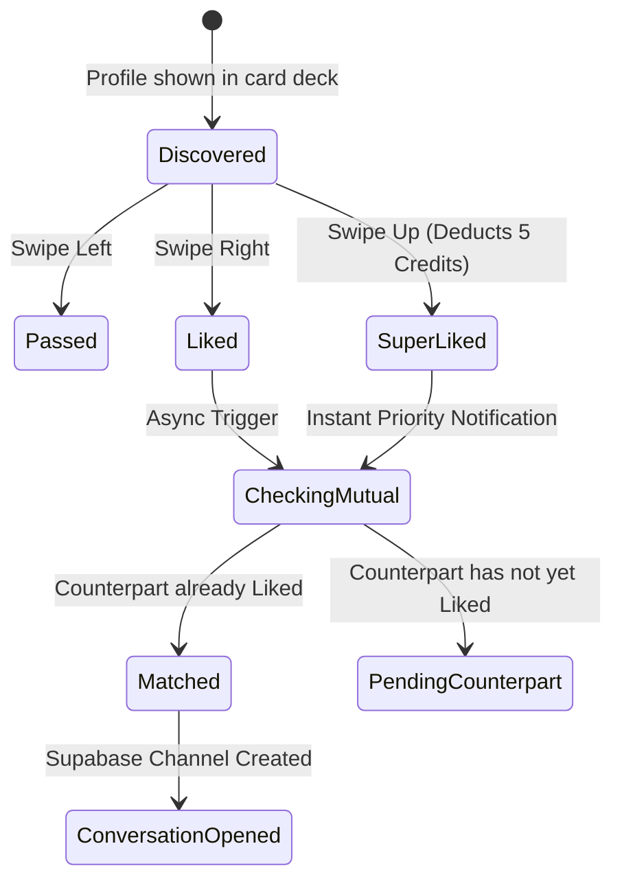

# [PRD]: Matching & Discovery Engine

- **Status**: `APPROVED`
- **Module Owners**: `LikesModule`, `MatchesModule`, `MatchResolverModule`
- **Tech Lead**: Backend Engineering Team
- **Last Updated**: 2026-09-12

---

## 1. Executive Summary

The **Matching & Discovery Engine** is the core engagement loop of BreathAway. It manages how potential connections are ranked, delivered to clients as discovery cards, and how swiping interactions (`LIKE`, `PASS`, `SUPER_LIKE`) convert into mutual matches.

---

## 2. Business Logic & Invariants



1. **Idempotency**: Swipes must include an `idempotencyKey` (UUIDv4) generated by the mobile client to prevent duplicate likes or double charges on flaky connections.
2. **Quota Enforcement**:
   - Free users receive 50 standard likes per rolling 24-hour period.
   - Subscribers have unlimited standard likes.
   - `SUPER_LIKE` consumes 5 credits from the user's `CreditAccount`.
3. **Mutual Matching Invariant**:
   - When User A likes User B, the backend checks for an existing `LIKE` from User B towards User A.
   - If present, a new `Match` record is created atomically within a database transaction, triggering match notifications to both users and creating a Supabase chat channel.
   - If not yet mutual, the like is stored in the database, and User A's profile is elevated in User B's discovery feed.

---

## 3. API Contract Specifications

### 3.1 Record a Like / Action

- **Endpoint**: `POST /api/v1/likes`
- **Guards**: `JwtAuthGuard`, `RequireTimezoneGuard`
- **Query Parameters**:
  - `async` (optional, boolean, default: `false`): When `false`, executes match resolution synchronously and returns `matchId` immediately. When `true`, delegates match resolution to an asynchronous background task.
- **Headers**:
  - `Authorization: Bearer <token>`
  - `x-timezone: <IANA-Timezone>` (e.g. `America/New_York`)
- **Request Body (`CreateLikeRequestDto`)**:
  ```json
  {
    "targetIdentityId": "01J23C4D5E6F7G8H9J0K1L2M3N",
    "intent": "CASUAL",
    "label": "Met at coffee shop"
  }
  ```
- **Response (`LikeResponseDto`)**: `201 Created`
  ```json
  {
    "id": "01M5F3E5DA9G9DMEM93V3K1T5F",
    "intent": "CASUAL",
    "status": "MATCHED",
    "label": "Met at coffee shop",
    "targetIdentity": {
      "id": "01J23C4D5E6F7G8H9J0K1L2M3N",
      "type": "PHONE_NUMBER",
      "value": "+1234567890",
      "isVerified": true
    },
    "matchId": "01M5F3E5DA9G9DMEM93V3K1T5M",
    "expiresAt": "2026-10-25T04:00:00.000Z",
    "createdAt": "2026-10-24T00:30:00.000Z"
  }
  ```

> [!NOTE]
> `matchId` is populated with the match identifier whenever `status` is `MATCHED`. When `status` is `PENDING`, `matchId` is `null`. Multi-channel user notifications (Push, Email, WhatsApp) are always dispatched asynchronously out-of-band via domain events (`MATCH_CREATED_EVENT`).

---

## 4. Non-Functional & Scaling Considerations

- **Response Latency**: The initial `POST /api/v1/likes` response must return in under 80ms. Heavy background resolution tasks (push notifications, BigQuery sync) are offloaded to GCP Pub/Sub workers.
- **Cache Invalidation**: Redis discovery deck caches for `targetUserId` are refreshed asynchronously upon match resolution.
